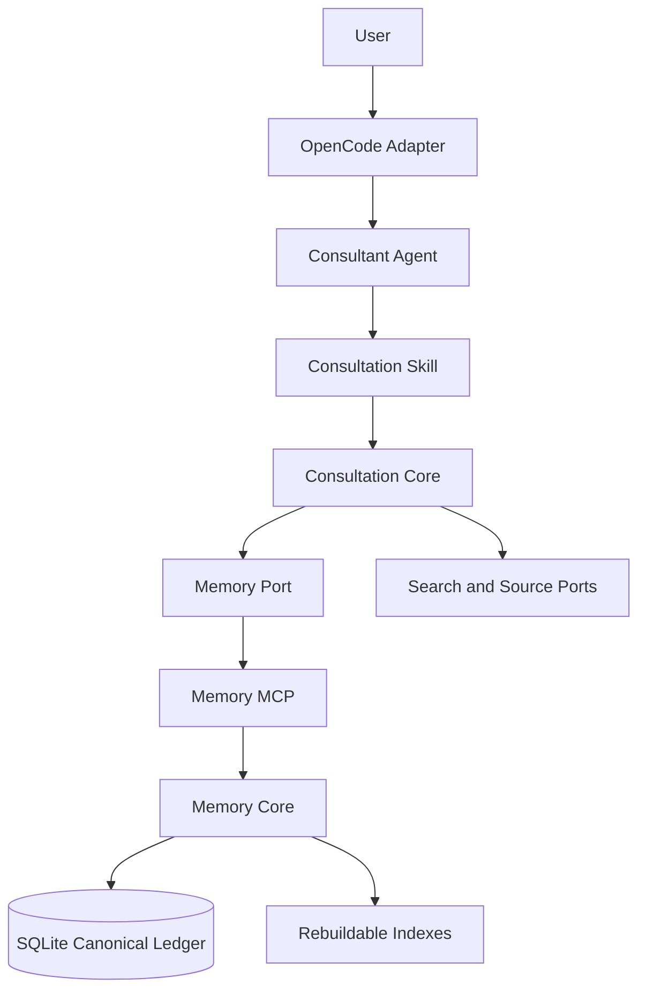
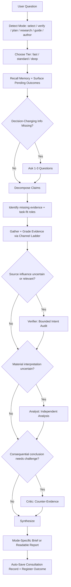

# Janus Agent Plugin Architecture

The living architecture specification for the janus-agent plugin, describing the current implementation and mechanism. Harness: OpenCode. The core is harness-neutral; Codex, Senpi, and other hosts plug in through thin adapters. Change history lives in git, not in this document.

## 1. Executive Decision

Build an independent Janus agent plugin with a harness-neutral consultation core, a harness-neutral memory core, a local SQLite store, a local MCP interface, and a thin OpenCode adapter.

The public experience is a small agent family with one default entry and three direct-entry shortcuts: `janus` (default general/routing), `consultant` (evidence-driven advice in six modes: `select`, `verify`, `plan`, `research`, `guide`, `author`), `coder` (coding with adaptive L0/L1/L2/L3 process weight), and `lite` (economical quick answers). The consultant leads the research team (`explorer`, `analyst`, `critic`, `verifier`) and the scoped-write writer; the coder owns the coding lanes (`coder-lite`, optional host `build`). In author mode the consultant and writer are separated: the consultant owns intake, evidence, the outline approval, final review, the author brief, memory, and publishing and writes no reader-facing prose; the `writer` is the sole author of reader-facing prose and, in scoped-write mode, the sole writer of approved document files under `writer_docs_roots`. The consultant produces decision briefs, playbooks, research reports, and durable documents behind one outline-approval gate, and distinguishes verified facts from synthesis. The coder discusses design/architecture before editing for multi-file or correctness-critical work and gates that discussion on user approval.

The memory system stores only user-approved experience packages. It does not automatically persist complete conversations. Canonical experience records remain independent of classification schemes, summarization models, embedding models, and storage indexes. Every derived view can be rebuilt.

Implementation must occur in a separate repository or directory selected by the user. No plugin code belongs in the current oh-my-openagent repository.

## 2. Product Goals

1. Give concise, human-friendly answers — a decision brief for decision questions, a readable report for understanding questions.
2. Resist rumors, correlated sources, marketing pressure, astroturfing, and unsupported consensus.
3. Apply different evidence standards to different claim types and risk levels.
4. Detect deliberate deception (paid shilling, coordinated smearing) in user-generated sources.
5. Preserve token efficiency through bounded research and progressive memory disclosure.
6. Accumulate user-approved experience without turning previous model conclusions into circular evidence.
7. Keep the core portable across agent harnesses and model providers.
8. Preserve provenance, revisions, deletion rights, and migration safety.

## 3. Non-Goals

The first version will not:

- join or modify the oh-my-openagent product architecture;
- support concurrent writers from multiple harnesses;
- synchronize memory across machines;
- create an account system or remote memory service;
- save full transcripts (only inductive summaries of consultation records);
- treat old recommendations as independent evidence;
- provide professional medical, legal, financial, or safety decisions;
- ship or require a separate `research-director` agent — deep research is a `research` mode of the consultant;
- make every consultation use multiple subagents.

## 4. Architecture Overview



### 4.1 Proposed Repository Shape

```text
janus-agent-plugin/
├── packages/
│   ├── consultation-core/
│   ├── memory-core/
│   ├── memory-sqlite/
│   ├── memory-mcp/
│   └── opencode-adapter/
├── assets/
│   ├── agents/consultant.md
│   └── skills/consultation/SKILL.md
├── evals/
├── docs/
└── package.json
```

This is one installable product with internal package boundaries. It is not a collection of separately configured user projects.

### 4.2 Dependency Direction

```text
consultation-core  memory-core
        ^              ^
        |              |
        +------ memory-sqlite
        |              ^
        +------ memory-mcp
        |
        +------ opencode-adapter
```

Core packages must not import OpenCode or the MCP SDK. Adapters translate host and transport concepts into core ports.

## 5. Component Responsibilities

### 5.1 Consultant Agent

The `consultant` primary agent owns the evidence workflow and final expression for consultation requests. `janus` is the default general/routing entry; `coder` owns coding; `lite` is the economical quick-answer leaf. The consultant routes every question to one of six modes — `select`, `verify`, `plan`, `research`, `guide`, or `author` — and a tier (fast, standard, or deep; `author` never uses fast). It:

- detects the mode from intent and chooses the tier;
- identifies decision-changing missing information;
- asks at most one to three initial questions when needed;
- invokes search, memory, the research team (explorer, analyst, critic, verifier), and the writer (sole author of reader-facing prose);
- retains final editorial control over delegated research and author-mode artifacts (review, verification, bounded writer fix requests) without writing prose itself;
- returns a mode-specific decision brief, a readable research report, or an authored document delivery;
- recognizes natural-language memory intents.

It does not directly implement persistence or source grading rules.

### 5.2 Consultation Skill

The reusable `consultation` skill defines the cognitive workflow:

- claim decomposition;
- evidence and source evaluation;
- risk classification;
- counter-evidence requirements;
- decision preference handling;
- confidence language;
- short output structure;
- memory preview and save behavior.

The skill is reusable by agents other than `consultant`. The agent prompt may preload it, but the skill remains the authoritative workflow source.

### 5.3 Consultation Core

The consultation core provides deterministic contracts and policy helpers. It owns:

- validated classifications and policy decisions;
- consultation intensity rules;
- risk rules;
- evidence packet schemas;
- fact, inference, preference, and prediction distinctions;
- output contracts;
- research budget enforcement;
- source and memory provenance requirements;
- ports for reasoning, search, memory, and clock.

Reasoning remains model-driven. The core validates structured model output and enforces rules that must not depend on prompt compliance.

### 5.4 Memory Core

The memory core owns:

- canonical experience schemas;
- revision and status transitions;
- progressive retrieval planning;
- taxonomy and tag relationships;
- provenance and validity rules;
- sensitive-field policies;
- forget and cascade-delete semantics;
- import, export, and rebuild contracts.

It does not know OpenCode sessions, MCP transports, or SQLite statements.

### 5.5 Memory SQLite Adapter

The SQLite adapter owns:

- schema migrations;
- transactions and idempotency;
- multi-process safety (WAL, busy timeout, write transactions);
- canonical record persistence;
- FTS indexes;
- derived summaries and embedding records;
- backup, recovery, and rebuild support.

### 5.6 Memory MCP

The local stdio MCP server exposes a stable cross-harness memory boundary. It remains thin and delegates all domain behavior to memory core.

### 5.7 OpenCode Adapter

The first adapter:

- registers the `janus` default entry, the `consultant` evidence entry, the `coder` coding entry, and the `lite` economical leaf;
- registers the research subagents — `explorer`, `analyst`, `critic`, and `verifier` (read-only, shell-denied, and dispatch-denied) and the `writer` scoped-write author executor (edit allowed only under the configured `writer_docs_roots`, default `userdoc`; an empty roots array selects the read-only fallback; shell and dispatch denied; step-capped at 80; the writer is optional via `writer_enabled`);
- creates the fixed author state directory (`$XDG_DATA_HOME/janus-agent/author`) where the consultant writes per-document briefs;
- registers the `coder-lite` mechanical coding lane (leaf, step-capped) and accepts the optional host `build` delegation target;
- makes the consultation skill available;
- registers or launches the bundled local memory MCP;
- maps OpenCode session IDs into namespaced core IDs;
- exposes model and provider configuration;
- installs the `janus-memory` browse command;
- does not contain evidence, recommendation, or persistence logic.

## 6. Consultation Workflow



`author` consultations run a dedicated state machine behind one outline-approval gate, with a strict author separation — the `writer` is the sole author of reader-facing prose and the consultant writes none:

```text
route -> intake (audience/delivery/scope) -> explore load-bearing claims
-> writer blueprint -> outline + file manifest -> one approval -> create the brief
-> writer produces bounded approved chapter drafts (and writes the approved
   files itself in scoped-write mode; returns prose or patches in read-only
   fallback) -> consultant reviews and verifies -> bounded writer fixes -> publish
-> proportionate verification -> cross-file check -> final AuthorBrief -> memory summary
```

The brief is the document's external state file at `<authorStateDir>/<projectId>/<docId>/brief.md` (fixed author state dir, stable project id): the consultant creates it at the outline gate, updates it at structural changes, and appends a change log; the writer reads it and never writes it. In this mode adversarial roles are proportionate, never a fixed roster: the critic runs for `strict` verification, conflicting evidence, high-risk material, failed execution, or material uncertainty it could resolve; the verifier audits user-generated, promotional, or purportedly independent evidence when influence or provenance is relevant or uncertain. After outline approval the writer may produce complete section/chapter prose from a bounded evidence packet and do targeted web lookups within a search budget, logging a source ledger; broad or contested research stays with the consultant, which routes it to `explorer` (the writer never dispatches explorer). The consultant verifies load-bearing claims against the writer's source ledger, checks cross-file consistency, and requests bounded writer fixes — in scoped-write mode (`writer_docs_roots` non-empty, default `["userdoc"]`) it does not edit files under the writer roots; in read-only fallback (`writer_docs_roots: []`) it applies and publishes the writer's returned text and discloses the mode. A delegated writer's host permissions are separate and are not enforced by this plugin.

### 6.1 Consultation Tiers

#### Fast

Use when the question is low-risk, directly verifiable, and minimally personalized.

- Prefer a primary authoritative source.
- Perform an exact or very small memory lookup.
- Do not invoke a subagent by default.
- Answer in one to several sentences when possible.

#### Standard

Use for comparisons, recommendations, personalization, or moderate inference.

- Check source independence and provenance.
- Search for counter-evidence.
- Retrieve relevant experience and preferences progressively.
- Dispatch a specialist when its check could materially affect the answer and you can name the decision it could change and the specific failure it would catch. Skip only with that reason; standard tier does not prescribe a roster.
- Return a mode-specific deliverable with the conclusion and next action in the first screen.

#### Deep

Use for high risk, strong source conflicts, missing primary evidence, inference-dominated conclusions, broad comparisons, or any research-mode question.

- Ask the user before escalating.
- Decompose consequential work and route to the specialists whose evidence, interpretation, independent challenge, influence audit, or authoring is relevant or uncertain. Deep tier does not require calling every role.
- Seek supporting and opposing evidence; audit source intent when influence or independence is relevant or uncertain.
- Keep final synthesis and output with the consultant agent.

Deep work is done by the consultant's own team. There is no separate deep-research provider; the `research` mode (§8) is the deep, understanding-oriented path.

### 6.2 Tier Decision Dimensions

The router evaluates:

1. potential harm from a wrong answer;
2. availability of authoritative primary sources;
3. conflict among reliable sources;
4. dependence on personal context;
5. proportion of synthesis versus direct evidence.

### 6.3 Team Roles and Tier Caps

The consultant leads four research subagent roles and the writer through `janus_dispatch`. Its skill is the authoritative task-fit policy: assign bounded work when a role could materially change the result and the consultant can name the decision it could change and the specific failure it would catch; skip only with that reason. Independent gathering may fan out; analysis follows evidence, critique follows a draft conclusion, and substantive authoring follows outline approval. The consultant retains final synthesis and delivery.

Entry roles and execution delegates are separate from this research roster: `janus` (default general entry), `consultant` (evidence entry), `coder` (coding entry), and `lite` (economical leaf) are user-selectable; `coder` owns the `coder-lite` mechanical lane and the optional host `build` escalation. The tier caps below apply only to the research team.

| Role | Purpose |
|---|---|
| `explorer` | gather and grade evidence (fan-out up to 5 instances) |
| `analyst` | independent cross-model reasoning over evidence |
| `critic` | adversarial counter-evidence pass; hard gate over research hypotheses |
| `verifier` | bounded audit of manipulation or opaque independence in user/third-party/promotional evidence; missing observations produce `unknown` |
| `writer` | sole author of reader-facing prose for `author` — blueprint before approval, section/chapter prose and maintenance after approval, coherence passes; targeted web lookups with a source ledger. Plugin-owned: shell and dispatch denied; edit allowed only under `writer_docs_roots` (read-only fallback when empty) |

Per-tier **maximum** instance counts (`TIER_ROLE_CAPS`, mirrored by the adapter's validated `tier_role_caps` config), never minimums or a required team roster:

| Tier | explorer | analyst | critic | verifier | writer |
|---|---|---|---|---|---|
| fast | 5 | 0 | 0 | 0 | 0 |
| standard | 5 | 1 | 1 | 1 | 1 |
| deep | 5 | 3 | 2 | 2 | 2 |

`author` never runs at fast tier. The writer is optional (`writer_enabled`, default true); when it is disabled or unavailable, author mode is unavailable — the consultant discloses which writer work is missing and offers to enable the writer, configure a delegate, or an explicit consultant-prose fallback the user accepts; it does not silently write reader-facing prose. The caps are passed to the consultant as configuration, not enforced by a per-turn runtime scheduler; zero means the role is unavailable at that tier and the consultant must disclose a material gap.

### 6.4 Recoverable Dispatch API

All roles share the same recoverable dispatch lifecycle; every agent resolves to a single configured model with no plugin fallback chain.

| Tool | Arguments | Contract |
|---|---|---|
| `janus_dispatch` | `{role, prompt}`; role is a configured dispatch role (`consultant`, `coder`, `lite`, the four research roles and the writer, `coder-lite`, or optional `build`) | Launch a durable host-session job and observe within a soft wait window |
| `janus_dispatch_wait` | `{job_id, wait_ms?}` | Recover/observe the same job; optional integer `wait_ms` is 0..300000, default 300000; zero performs a snapshot |
| `janus_dispatch_cancel` | `{job_id}` | Request explicit cancellation and reconcile durable completion/abort evidence |

Launch uses a 300000 ms soft observation window, not a specialist execution deadline. Completed usable reports remain plain text and confirmed failures use `Error:` text. Nonterminal JSON envelopes identify `job_id`, `session_id`, `role`, `attempt`, `status` (`pending`, `unknown`, or `cancelling`) and `next: "janus_dispatch_wait"`. A `cancelled` envelope requires confirmed abort evidence; normal completion racing cancellation wins and preserves the original report.

Expiry or an observation-context abort stops waiting, not the child job. Pending means work remains active; unknown means available host evidence does not establish the outcome, not confirmed failure. Keep the same job ID for later waits, including through a fresh coordinator after restart, without a duplicate generating request. Wait/cancel enforce the caller's parent session and workspace ownership. Only explicit cancellation requests may abort work; cancellation remains `cancelling` until reconciled.

Each job is a durable host session rooted under the caller's session (`[consultation-dispatch:v1] <role>`). The first attempt's generation runs directly in that job session, so the dispatched prompt and the specialist's live messages are visible there; journal records are written as ignored/synthetic user messages and stay out of the conversation. Every job is a single attempt.

The consultant may do independent preparation within existing permissions and caps while waiting, but must integrate the eventual specialist report before dependent synthesis and cannot silently substitute inline work or claim an independent check that did not return. Execution status comes from host session/message evidence, not from specialist liveness assertions. A verifier's evidence-quality `unknown` is distinct from a dispatch execution `unknown`.

Every role has one configured attempt and every agent resolves to a single model; no failure kind — pending, unknown, non-retryable, or confirmed retryable — triggers a plugin fallback advance. A delegated writer also has one configured attempt, with either a pinned model or host model selection (`null` in the durable spec), and retains host-defined permissions. This describes plugin model resolution, not the external host's internal retry policy. See [the per-role audit matrix and verification levels](../evals/README.md#per-role-audit-matrix).

## 7. Epistemic Model

### 7.1 Claim Types

Every consultation is decomposed at claim level, not only by domain:

- verifiable fact;
- causal or efficacy claim;
- experiential judgment;
- future prediction;
- value preference and decision.

The domain determines relevant sources. The claim type determines verification method.

### 7.2 Source Evaluation

Sources are graded relative to the claim using:

- primary versus secondary status;
- expertise or legal accountability for the claim;
- transparent and reproducible method;
- independence and original provenance;
- commercial or ideological conflicts;
- recency, region, and applicability;
- independent support or contradiction.

Grades are `high`, `medium`, `low`, and `lead_only`. Numerical trust percentages are prohibited unless backed by real calibrated data.

Niche sources, forums, and social platforms are normally leads, counterexamples, or experience reports. Obscurity is never a credibility bonus.

Reliability grading assumes honest-but-flawed sources. Deliberate deception and opaque independence (water armies, coordinated smearing, undisclosed sponsorship, astroturfing, and purportedly independent promotional evidence) receive a bounded `verifier` audit when potentially relevant, not only after manipulation is proved: each source is annotated `clean`, `suspect_shill`, `suspect_smear`, or `unknown` from observable signals (temporal bursts, cross-account phrase repetition, account history, disclosure, reviewer target concentration, publisher affiliation, and others). Missing account, sponsorship, or comparison data require `unknown`, not an unsupported `clean`. Suspicion is graded with a stated basis, never ground truth. Explorer and consultant still verify the underlying factual claim.

### 7.3 Facts and Inference

The selected reasoning policy is balanced:

- verified facts and synthesized inferences must be presented separately;
- every atom (claim, candidate, step) carries an epistemic status: `verified`, `refuted`, `inferred`, or `unverifiable`;
- `inferred` and `unverifiable` must carry a `basis` recording the reasoning chain ("inferred Y from X") — a bare conclusion is forbidden;
- multiple independent reports and a plausible mechanism may justify a provisional inference;
- synthesis cannot create missing facts;
- correlated reposts count as one source chain;
- important conclusions require a counter-evidence pass;
- insufficient evidence is an acceptable result.

### 7.4 Risk Policy

#### Low Risk

Low cost, reversible, and unlikely to cause persistent harm. Weak evidence may support a cautious trial with clear stopping conditions.

#### Medium Risk

Meaningful cost or side effects. Ask for relevant context, require stronger evidence, and provide an exit strategy.

#### High Risk

Medical treatment, medication, vehicle safety, law, major financial consequences, or irreversible effects. Weak evidence cannot support a recommendation. The agent provides evidence and options but does not replace a qualified professional or make the decision for the user.

Health threshold: recommend consulting a professional only on a hard trigger (medical intervention, prescription/OTC dosage, chronic-condition management, pregnancy or nursing, minors, interaction with an existing condition or medication, irreversible or high-risk body procedure). On a soft trigger — a health or body side effect with low evidence confidence — add one line suggesting a professional consult or starting low. Otherwise give the advice plainly; do not reflexively disclaim.

### 7.5 Decision Model

Evidence and preference are separate layers:

- evidence establishes attributes and uncertainty;
- user preferences assign decision weight;
- missing preferences use explicit defaults;
- outputs state what condition would change the recommendation;
- the agent may conclude that there is no reliable unique winner.

### 7.6 Confidence Model

Use two qualitative dimensions:

- **Evidence confidence:** high, medium, or low
- **Recommendation stability:** stable, conditional, or provisional

Do not output invented numerical confidence.

## 8. Research Mode

Deep, understanding-oriented investigation is a `research` mode of the consultant, not a separate agent or external provider. The consultant detects understanding-seeking intent (open-ended questions, "深度研究", topic surveys) and runs the mode with its own team:

- decompose the question into sub-directions;
- gather missing or uncertain evidence with independent explorers, parallelizing only independent searches;
- compare consensus, disagreements, and gaps;
- form multiple hypotheses with confidence, actively seeking counterexamples;
- challenge consequential hypotheses with a critic pass when you can name a counterexample or alternative that would change the report;
- synthesize a readable report (bottom line up front, plain language, evidence and disagreements under `证据与来源（可跳过）`).

The research report is a validated contract (`ResearchBriefSchema`): a one-line bottom line, plain-language key points, an implications line, and confidence, with hypotheses, disagreements, residual uncertainty, and sources under `证据与来源（可跳过）`. There is no separate deep-research provider or `research-director` agent.

## 9. Canonical Memory Model

### 9.1 Stored Entities

| Entity | Purpose |
|---|---|
| `SessionExperience` | One user-approved experience package per host session |
| `ExperienceItem` | A distinct topic inside a session package |
| `Claim` | A proposition with time, region, and applicability |
| `Evidence` | Source metadata and a necessary lawful excerpt |
| `EvidenceLink` | Supports, refutes, qualifies, or supersedes a claim |
| `Decision` | The conclusion, assumptions, preferences, and confidence at that time |
| `Revision` | Why a later conclusion changed the previous state |
| `UserPreference` | A user-confirmed stable preference or constraint |
| `TaxonomyNode` | A versioned category node |
| `TagMembership` | A many-to-many classification link |
| `DerivedSummary` | A rebuildable summary with model and prompt version |

### 9.2 Canonical Versus Derived Data

Canonical data includes user-approved experience records, source metadata, necessary excerpts, decisions, preferences, and revision events.

Derived data includes:

- classifications;
- tags;
- summaries;
- embeddings;
- graph projections;
- ranking caches.

Derived data must record schema, model, prompt, and generation time. It must be safe to delete and rebuild without losing accepted experience.

### 9.3 Revision States

- `active`: eligible for normal retrieval and recommendation
- `superseded`: retained for historical explanation
- `refuted`: used only for contradiction and misinformation checks
- `retired`: excluded from default retrieval
- `forgotten`: canonical and derived content has been erased

An old recommendation is a counter-hypothesis, not counter-evidence. Only its underlying source or recorded outcome can act as evidence.

## 10. Memory Capture Protocol

### 10.1 Natural-Language Intents

The agent recognizes intent rather than fixed commands.

Examples:

- “Summarize what we learned” means preview only.
- “Remember this experience” means preview, sensitive-field review, then commit.
- “Forget that preference” means identify the target, confirm destructive scope, then erase.

### 10.2 One Package Per Session

A session has one `SessionExperience`, but that package may contain several topic-specific `ExperienceItem` records.

Repeated saves:

- update the same session package;
- add a new item for a new topic;
- create a revision for a changed conclusion;
- remain idempotent under retries;
- do not create duplicate ranking candidates.

### 10.3 Save Preview

The preview shows:

- what conclusions and evidence will be saved;
- applicable time, region, and conditions;
- proposed categories and tags;
- user preferences;
- sensitive fields requiring explicit confirmation.

The complete transcript is not saved by default.

### 10.4 Auto-Save

At the end of every consultation the consultant automatically saves the consultation record(s) — no user instruction required. The saved unit is one consultation: a question summary plus a conclusion summary, with the supporting claims, evidence (provenance and grade), and preferences. If a conversation held several distinct questions, each becomes its own record; if it was one question explored in depth, it is one record with a refined conclusion. Before saving, prior consultations are recalled; a very similar new consultation updates the prior record (conclusion changes go through a revision) instead of duplicating.

Never saved: the full transcript, unverified search fragments, hidden chain-of-thought, duplicate sources, ordinary conversation, or credentials. Sensitive fields are excluded from auto-save and persist only after itemized confirmation.

## 11. Memory Organization and Retrieval

### 11.1 Hybrid Organization

Use three overlapping structures:

1. a small versioned top-level taxonomy with dynamic descendants;
2. many-to-many tags and evidence relationships;
3. global lexical and semantic indexes as a recall safety net.

Cross-category experience is linked to multiple categories without copying canonical content.

### 11.2 Progressive Disclosure

Retrieval levels are:

1. index title, time, status, and one-line summary;
2. claim, applicability, and current decision;
3. supporting and opposing evidence plus revision history;
4. lawful source excerpt and full stored reasoning summary.

The default query retrieves level 1 and only the necessary level 2 records. Levels 3 and 4 require explicit expansion by the agent or user.

### 11.3 Hybrid Recall

Candidate generation combines:

- taxonomy branch selection;
- SQLite FTS;
- configurable embedding similarity;
- support, refute, and revision relationships;
- time, region, and applicability filters;
- user preference relevance.

Results are deduplicated by canonical identity and source provenance.

Initial benchmark defaults:

- return at most eight level-1 candidates;
- expand at most three candidates without another decision;
- cap injected memory at approximately 1,200 tokens for standard consultation;
- broaden retrieval only when confidence is low, candidates conflict, or recall is insufficient.

These are tuning defaults, not persistence or API contracts.

### 11.4 Retrieval by Consultation Tier

- Fast: exact or minimal lookup only
- Standard: automatic taxonomy and hybrid recall
- Deep: include prior disputes, refuted claims, and historical revisions as research leads

The user can disable memory for a single consultation.

If stored memory materially changes the recommendation, the answer must disclose which preferences or experience were used. Sensitive memory usage must always be disclosed.

## 12. MCP Surface

Keep the agent-facing surface small:

1. `memory_recall`
2. `memory_expand`
3. `memory_prepare`
4. `memory_commit`
5. `memory_manage`

Maintenance operations (export, import, migration, integrity checks, reindexing) and offline browsing of the consultation record (list, show, search, delete, forget) belong in the CLI rather than permanent agent tool definitions. The database is opened in WAL mode with a busy timeout and every write runs in a short transaction, so the CLI and any number of live memory MCP servers (one per OpenCode window) can use the store concurrently.

The MCP transport is local stdio. The server contains no consultation policy and no model-specific reasoning.

The memory server is registered globally on the host config (`config.mcp`), so it is agent-agnostic — any agent in the session can call the memory tools, not only the `consultant`. Memory is a shared service, not bound to one agent.

## 13. Storage Architecture

### 13.1 Default Paths

Use XDG paths with configurable overrides:

```text
$XDG_DATA_HOME/janus-agent/memory.sqlite3
$XDG_STATE_HOME/janus-agent/
$XDG_CACHE_HOME/janus-agent/
```

The database and user-controlled exports belong in data. Locks, pending enrichment state, and operational records belong in state. Rebuildable query caches belong in cache.

The final product slug can change when the independent repository is named, but the config/data/state separation is fixed.

### 13.2 SQLite Policy

The first version uses SQLite because it provides local transactions, atomic commits, schema constraints, FTS, and crash recovery without a separate service.

Required rules:

- one active writer enforced by a lock;
- multiple readers may be allowed by SQLite;
- every save is transactional and idempotent;
- foreign keys and integrity constraints are enabled;
- canonical writes complete before deferred enrichment;
- the database is not supported on network filesystems;
- migrations create a backup and support recovery;
- interrupted derived work remains retryable.

### 13.3 Model Independence

The summarization model and embedding model are configurable separately. The raw accepted record never depends on either model. A model change creates new derived artifacts and leaves canonical data untouched.

## 14. Privacy, Deletion, and Source Safety

### 14.1 Sensitive Data

Sensitive fields are not persisted by default. If the user requests persistence, the preview lists each field separately and requires confirmation.

Users can inspect, modify, retire, or erase stored preferences. The system must not create a sensitive profile through silent inference.

### 14.2 Retire Versus Forget

`retire` preserves audit history but removes a memory from normal retrieval.

`forget` deletes canonical content and all derived summaries, embeddings, tags, and caches. Remaining relationships may retain only a content-free tombstone needed for structural integrity.

### 14.3 External Sources

Store by default:

- URL or stable source identifier;
- title, author or institution, publication date, and access date;
- only the necessary lawful excerpt;
- a content fingerprint;
- how the source supported or challenged a claim.

Do not mirror a complete page or paid report unless the user is authorized and explicitly requests it.

### 14.4 Prompt Injection

All external sources and remembered content are untrusted data, never instructions.

The system must:

- ignore embedded attempts to alter agent policy;
- block requests to execute commands or expose local data;
- prevent malicious source text from becoming a system instruction;
- lower source trust when manipulation is detected;
- warn the user for confirmed attacks or when a source must be excluded;
- avoid repeating the full malicious payload.

## 15. Failure Handling

| Failure | Required Behavior |
|---|---|
| Memory MCP unavailable | Continue without memory and state that saving is unavailable |
| Retrieval error | Do not claim that no prior experience exists |
| Embedding unavailable | Fall back to taxonomy and FTS |
| Search unavailable | State that current factual verification could not be completed |
| Summary or classification fails | Keep the canonical record pending enrichment |
| Another process holds the write lock | Wait up to the busy timeout, then fail with a retryable database-locked error |
| Save request retried | Return the existing idempotent result |
| Migration fails | Roll back the migration transaction, leave the database unchanged, and stop |
| Prompt injection detected | Block it, log a sanitized event, and notify according to severity |

## 16. User-Facing Output Contract

The output is terminal-first and length adapts to decision complexity, not tier alone.

### Double anchor

Full answers start with `结论 / 理由 / 下一步` and end with `一句话 / 下一步` as the last two lines. The mode body sits between them. Evidence, grades, disagreements, and confidence rationale go under `证据与来源（可跳过）` before the bottom anchor, so a reader who jumps to the end still lands on the conclusion. Short answers use the top anchor only.

### Confidence and alternatives

Use `把握：高 / 中 / 低 — why` when confidence is not high or the top alternatives are close. Never present medium/low confidence as certain. `select` and `guide` may say "没有明显赢家" and give a tie-break instead of forcing a winner. `plan` starts with `可行 / 有条件可行 / 不建议` and names the condition and failure mode. `verify` may conclude `无法核实` and name the missing evidence.

### Mode bodies

- **select** — selection criteria → candidate short reviews → trial/switch. Short: conclusion + 2–3 reasons + one trial.
- **verify** — key reasons → what would change the verdict → contested-claim details. Short: verdict + 2 reasons + what would settle it.
- **plan** — feasibility → constraints/risks → steps → stop/rollback → alternative. Short: feasibility + 3–5 steps + stop condition.
- **research** — bottom line → 3–5 key points → what it means → disagreements/uncertainty. No forced recommendation.
- **guide** — shortest path → suitability/prerequisites → recommendation (when real choices) → steps → pitfalls → completion check. Carries at least a recommendation or a procedure.
- **author** — status/location → scope → document map → verification → next action. The chat output is a delivery brief, not the document body.

### Terminal conventions

Paragraphs are 1–3 sentences; bullet depth is at most 2; headings are at most 3. Tables are at most 3–4 columns with short cells; wider or sentence-heavy tables become `label: value` lines. 100–120 characters is a comfort zone, not a hard limit. No academic filler or method narration before the answer. Every answer ends with an action, even when abstaining.

The exact templates live in the `consultation` skill. `AuthorBrief` remains the validation/memory unit; authored files are caller-approved side products referenced by the brief, not stored in memory.

## 17. Verification Strategy

### 17.1 Consultation Evaluation Cases

- a simple authoritative fact routes to fast consultation;
- multiple articles with one original source count as one chain;
- official and independent measurements are reconciled by conditions;
- a popular unsupported claim is not repeated as fact;
- weak evidence can support only a low-risk, reversible trial;
- high-risk advice does not replace a professional decision;
- changing a user preference changes the ranking when expected;
- insufficient evidence leads to honest abstention;
- prompt injection is blocked and reported;
- deep consultation asks before consuming the larger budget;
- a composite end-to-end request routes to the guide mode and carries at least a recommendation or a procedure;
- a durable tutorial or course request routes to the author mode with the correct profile instead of research or guide;
- a large author request presents an outline and file manifest and waits for exactly one approval before drafting chapters;
- targeted author verification checks representative code without invoking the critic or verifier by default.

### 17.2 Memory Evaluation Cases

- cross-category experience is recalled;
- a misclassified record remains discoverable through FTS or semantics;
- semantically equivalent wording retrieves the same experience;
- refuted memory never enters positive recommendation ranking;
- material preference use is disclosed;
- progressive disclosure stays within its token budget;
- repeated session saves do not duplicate experience;
- sensitive fields remain absent without confirmation;
- forget removes canonical and derived content;
- indexes rebuild after model changes;
- interrupted enrichment does not damage canonical records;
- a second writer cannot corrupt the database.

### 17.3 Integration Verification

Run a real isolated OpenCode instance and prove:

- the plugin loads;
- the consultant agent is selectable;
- the skill instructions are active;
- the local memory MCP starts;
- preview does not persist;
- commit persists and survives restart;
- repeated commit updates one session package;
- recall uses progressive disclosure;
- no data is written into the plugin installation directory.

## 18. First-Version Scope

The first version includes:

- independent plugin packaging;
- the `janus` default entry, `consultant` evidence entry, `coder` coding entry, and `lite` economical leaf;
- the four read-only research subagents, the scoped-write writer, and the `coder-lite` mechanical lane;
- the reusable consultation skill;
- consultation and memory core packages;
- SQLite persistence with FTS;
- configurable semantic retrieval;
- five memory MCP operations;
- one session experience package with topic items;
- preview, commit, revise, retire, and forget;
- evaluation fixtures and isolated OpenCode integration tests.

Future versions may add:

- Codex and Senpi adapters;
- safe concurrent writers;
- cross-device synchronization;
- optional graph database projections;
- scheduled outcome follow-up;
- remote shared memory services.

## 19. Industry and Platform Rationale

The design follows these documented patterns:

- OpenCode plugins can register tools, mutate configuration, and ship as npm packages or local plugin modules: <https://opencode.ai/docs/plugins>
- OpenCode custom agents support primary and subagent modes with permission rules: <https://github.com/anomalyco/opencode/blob/dev/packages/web/src/content/docs/agents.mdx>
- The MCP TypeScript SDK recommends stdio for local client-spawned servers and separates transports from server capabilities: <https://github.com/modelcontextprotocol/typescript-sdk/blob/v1.29.0/docs/server.md>
- The XDG Base Directory specification separates configuration, durable data, state, cache, and runtime files: <https://specifications.freedesktop.org/basedir/latest/>
- SQLite documents atomic commit behavior and crash recovery: <https://sqlite.org/atomiccommit.html>
- SQLite WAL supports concurrent readers with a single writer, while retaining one-writer semantics: <https://www.sqlite.org/wal.html>
- Letta documents tiered context and progressive loading rather than injecting all memory: <https://docs.letta.com/guides/core-concepts/memory/context-hierarchy/>
- Graphiti preserves episode provenance and temporal validity for derived facts: <https://github.com/getzep/graphiti/blob/main/README.md>
- LangMem distinguishes immediate and deferred memory formation: <https://langchain-ai.github.io/langmem/guides/delayed_processing/>
- LangGraph stores use namespaces, metadata filters, and semantic search for long-term memory: <https://docs.langchain.com/oss/python/langgraph/stores>
- Mem0 documents extracted, scoped memory and explicit memory operations: <https://docs.mem0.ai/core-concepts/how-it-works>

The architecture borrows ideas, not runtime dependencies. The first version remains a small local TypeScript plugin rather than adopting Letta, LangGraph, Graphiti, or Mem0 as its application runtime.

## 20. Pre-Implementation Input

Before implementation begins, the user must provide:

1. the independent repository URL or a local parent directory in which to create it;
2. the final product and npm package name.

The consultant's configured model is the default summarization model. An embedding model is optional; without one, retrieval remains functional through taxonomy, relationships, and FTS.

No implementation should begin in the oh-my-openagent repository.
