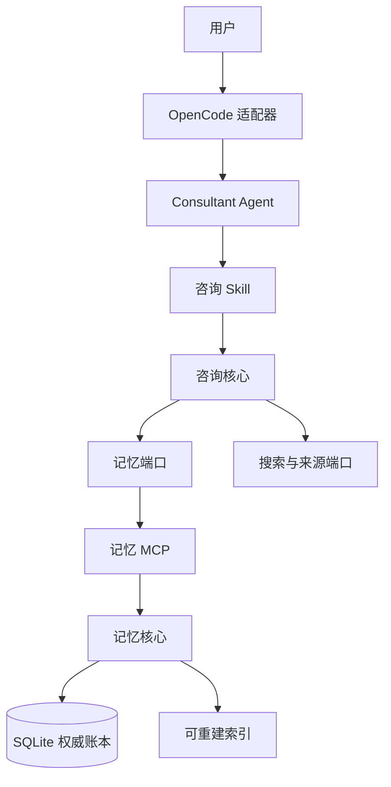
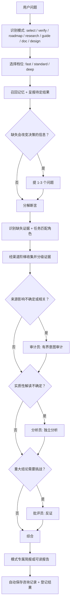

# Janus Agent Plugin 架构

本文档是 janus-agent 插件的现行架构规范，描述当前实现与机制。宿主：OpenCode。核心与宿主无关；Codex、Senpi 及其他宿主通过薄适配器接入。变更历史由 git 承载，不在本文档中。

## 1. 总体决策

构建一个独立的 Janus agent 插件：宿主无关的咨询核心、宿主无关的记忆核心、本地 SQLite 存储、本地 MCP 接口，以及一个薄的 OpenCode 适配器。

对外体验是三团队之上的 14 角色家族，外加两个独立入口：`janus`（默认前台/路由）与 `simple`（经济型快答）。**咨询团队**是 `consultant` 加 `common-explorer`、`consultant-analyst`、`consultant-critic`、`consultant-auditor`；它以五种模式——`select`、`verify`、`roadmap`、`research`、`guide`——负责证据驱动的建议。**研发团队**是 `architect` 加 `coder` 与 `coder-reviewer`/`coder-lite` 车道；`architect` 负责系统设计与 `design.md` 记录，`coder` 以自适应 L0-L3 过程权重负责实现，`coder-reviewer` 对单向门设计做事前验尸并审查 coder 的计划/diff。**文档团队**是 `author` 加 `author-writer` 与 `author-reviewer`，构成跨模型家族的三方闭环（Google 主编、Anthropic 主笔、Moonshot 审稿）；`author` 负责接单、证据、大纲审批、作者简报、验证与发布，不写读者可见正文；`author-writer` 是读者可见正文的唯一执笔者，且在限定写入模式下是 `writer_docs_roots` 之下已批准文件的唯一写入者；`author-reviewer` 是只读独立审稿人，在 `architecture` 文档或 `targeted`/`strict` 验证级别下于主笔成稿后把关事实、简报对齐与阅读友好度。`consultant`、`architect`、`author` 之间移交工作，而不是吞并其他团队的领地。

记忆系统只存储用户批准过的经验包。它不自动保存完整对话。权威经验记录独立于分类方案、摘要模型、embedding 模型与存储索引。每个派生视图都可重建。

## 2. 产品目标

1. 给出简洁、人类友好的回答——决策问题给决策简报，理解问题给可读报告。
2. 抵御谣言、相关联来源、营销压力、水军造势与无依据的共识。
3. 对不同断言类型与风险等级施加不同的证据标准。
4. 在用户生成内容中检测刻意欺骗（付费吹捧、协同抹黑）。
5. 通过有界研究与渐进式记忆披露保持 token 效率。
6. 积累用户批准的经验，而不把先前的模型结论变成循环证据。
7. 保持核心在不同 agent 宿主与模型提供商之间的可移植性。
8. 保护溯源、修订、删除权与迁移安全。

## 3. 非目标

本插件不做：

- 支持多宿主并发写入；
- 跨机器同步记忆；
- 建立账户系统或远程记忆服务；
- 保存完整对话记录（只保存咨询记录的归纳式摘要）；
- 把旧建议当作独立证据；
- 提供专业的医疗、法律、金融或安全决策；
- 发布或要求独立的 `research-director` agent——深度研究是 consultant 的 `research` 模式；
- 让每次咨询都用多个子 agent。

## 4. 架构总览



### 4.1 仓库形态

```text
janus-agent-plugin/
├── packages/
│   ├── consultation-core/
│   ├── memory-core/
│   ├── memory-sqlite/
│   ├── memory-mcp/
│   └── opencode-adapter/
├── skill-src/consultation/    # skill 源（绝不随包发布）
├── assets/
│   ├── agents/consultant.md
│   ├── principles/*.md        # 公共基线/写入门 + 共享提示词片段
│   └── skills/consultation/SKILL.md   # 由 skill-src/ 生成
├── evals/
├── docs/
└── package.json
```

这是一个带内部包边界的单一可安装产品，不是一组分别配置的用户项目。

### 4.2 依赖方向

```text
consultation-core  memory-core
        ^              ^
        |              |
        +------ memory-sqlite
        |              ^
        +------ memory-mcp
        |
        +------ opencode-adapter
```

核心包不得导入 OpenCode 或 MCP SDK。适配器把宿主与传输概念翻译为核心端口。

## 5. 组件职责

### 5.1 Consultant Agent

`consultant` 主入口负责五种咨询模式的证据流程与最终表达。`janus` 是默认前台；`simple` 是经济叶节点；`architect` 负责设计；`coder` 负责编码；`author` 负责持久文档。consultant 把每个请求路由到 `select`、`verify`、`roadmap`、`research` 或 `guide` 之一，并选择档位（fast、standard 或 deep；`roadmap` 与 `guide` 从不用 fast）。它：

- 从意图识别模式并选择档位；
- 识别会改变决策的缺失信息；
- 必要时至多提一到三个初始问题；
- 调用搜索、记忆与咨询团队（`common-explorer`、`consultant-analyst`、`consultant-critic`、`consultant-auditor`）；
- 把最终综合与验证留在自己手里，把检索类工作交给团队，但不写正文、不写生产代码；
- 返回模式专属的决策简报、可读研究报告或复合攻略；
- 把 `design` 工作移交给 `architect`、持久文档移交给 `author`；
- 识别自然语言的记忆意图。

它不直接实现持久化或来源分级规则。

### 5.1.1 模式栈与按需手册

consultant 在其五个证据模式上共用一个会话：每一轮重新评估诉求，并把已验证的证据、约束与已接受的决策向前携带。切换到 `design` 或 `doc` 是向 `architect` 或 `author` 的移交，由它们载入 `consultation-design` 或 `consultation-doc`；嵌套的局部未知会暂停主模式，派发一个有界的 `common-explorer`/`consultant-analyst` 任务后恢复。可能被反复回访的 `coder` 或 `author-writer` 任务以 `return_handle: true` 派发，并由其归属入口通过 `janus_dispatch_continue` 续接。只有核心 `consultation` skill 常驻相关；重型手册按需载入。

### 5.2 咨询 Skill

可复用的核心 `consultation` skill 定义共享的认知流程；`consultation-design` 与 `consultation-doc` 承载重型设计与文档手册，按需载入：

- 断言分解；
- 证据与来源评估；
- 风险分类；
- 反证要求；
- 决策偏好处理；
- 把握度语言；
- 短输出结构；
- 设计方法（准入、分层决策、质量场景、可逆性门、设计记录）；
- 记忆预览与保存行为。

这些 skill 可被 `consultant` 之外的 agent 复用。agent 提示词可以预载核心 skill，但 skill 始终是权威流程来源。`skill-src/{consultation,consultation-design,consultation-doc}/**` 是唯一事实源，`script/gen-skill.ts` 生成三个 `assets/skills/*/SKILL.md`（已接入构建）；过期测试会报错。`script/skill-consistency.test.ts` 检查七模式 schema 与 consultant 提示词、生成的 skill、eval 的 `modes` 元数据一致；`script/prompt-lint.test.ts` 强制每 skill 字数预算与重复句纪律。

### 5.3 咨询核心

咨询核心提供确定性契约与策略辅助。它负责：

- 校验过的分类与策略决策；
- 咨询强度规则；
- 风险规则；
- 证据包 schema；
- 事实、推断、偏好与预测的区分；
- 输出契约；
- 研究预算强制；
- 来源与记忆溯源要求；
- 推理、搜索、记忆与时钟的端口。

推理仍是模型驱动的。核心校验结构化的模型输出，并强制那些不能依赖提示词自觉遵守的规则。

### 5.4 记忆核心

记忆核心负责：

- 权威经验 schema；
- 修订与状态迁移；
- 渐进式检索规划；
- 分类与标签关系；
- 溯源与有效性规则；
- 敏感字段策略；
- 遗忘与级联删除语义；
- 导入、导出与重建契约。

它不知道 OpenCode 会话、MCP 传输或 SQL 语句。

### 5.5 记忆 SQLite 适配器

SQLite 适配器负责：

- schema 迁移；
- 事务与幂等；
- 多进程安全（WAL、busy timeout、写事务）；
- 权威记录持久化；
- FTS 索引；
- 派生摘要与 embedding 记录；
- 备份、恢复与重建支持。

### 5.6 记忆 MCP

本地 stdio MCP 服务器暴露一个跨宿主稳定的记忆边界。它保持薄，把全部领域行为委托给记忆核心。

### 5.7 OpenCode 适配器

适配器：

- 注册六个主入口——`janus`（前台）、`simple`（经济叶节点）、`consultant`（咨询团队）、`architect`（研发设计）、`coder`（研发实现）、`author`（文档）；
- 注册咨询子 agent——`common-explorer`、`consultant-analyst`、`consultant-critic`、`consultant-auditor`（只读、禁 shell、禁派发）；
- 注册研发子 agent `coder-reviewer`（只读审查）与 `coder-lite`（初中级工程师车道、叶节点、步数上限 80，bash 全允许加 VCS 写/还原与破坏性删除护栏），以及文档子 agent `author-writer`（仅允许编辑配置的 `writer_docs_roots` 之下，默认 `userdoc`；空根数组选择只读回退；禁 shell 与派发；步数上限 80）与 `author-reviewer`（默认 `opencode-go/kimi-k3.1-pro`；只读：`edit`/`bash`/`task`/`webfetch`/`websearch` 全拒，仅授予 author 与 design 状态目录的 `external_directory` 读权限；`architecture`/`targeted`/`strict` 门禁；不在 `tier_role_caps` 中）；
- 创建固定的 author 状态目录（`$XDG_DATA_HOME/janus-agent/author`，`author` 在其中写每篇文档的简报）、design 状态目录（`$XDG_DATA_HOME/janus-agent/design`，`architect` 在其中写 `design.md` 的决策内容），以及跨团队 handoff 状态目录（`$XDG_DATA_HOME/janus-agent/handoff`，五个主入口在其中追加 `handoff.md` 文档）；`author` 拥有 author 与 design 两目录权限，`architect` 拥有 design 目录权限，`coder` 拥有 design 目录权限（读 `design.md`、写 `plan.md` 与其生命周期行）；handoff 目录由 `janus`、`consultant`、`architect`、`coder`、`author` 五者共享，是 `consultant` 与 `janus` 唯一持有的业务态目录；
- 提供核心咨询 skill 及其设计/文档子 skill；
- 注册或启动内置的本地记忆 MCP；
- 把 OpenCode 会话 ID 映射为带命名空间的核心 ID；
- 暴露模型与提供商配置；
- 安装 `/janus-memory` 浏览、`/janus-models` 模型轮换、`/janus-handoff` 交接管理、`/janus-config` 配置编辑四条命令（`/janus-config` 经 `janus_config` 工具读写配置：字段目录 `config-catalog.ts`、保留注释的校验写入 `config-editor.ts`；第 10 组经 `janus_provider_keys` 工具与终端 `janus-keys` 管理 OpenCode provider 的命名 key，候选库为 `provider-keys.json`，切换时写入 OpenCode `auth.json`）；
- 按「角色 asset + 模型块 + 共享片段（`research-leaf`、`reasoning-failures`、`dispatch-hub`）+ 公共基线 + 公共写入门（只读角色跳过）+ 运行时绑定」组装每个提示词，每个角色配一份经评审的金样快照；
- 不包含证据、建议或持久化逻辑。

## 6. 咨询工作流



`doc` 咨询在一道大纲审批门之后运行专属状态机，并保持严格的作者分离——`author-writer` 是读者可见正文的唯一执笔者，`author` 一字不写：

```text
路由 -> 接单（受众/交付/范围）-> 勘察承重断言
-> author-writer 蓝图 -> 大纲 + 文件清单 -> 一次批准 -> 创建简报
-> author-writer 产出有界的已批准章节草稿（限定写入模式下亲自写已批准的文件；
   只读回退时返回正文或补丁）-> 审查与验证
-> author-reviewer 独立审稿门禁（architecture 文档 / targeted、strict 验证；
   light 非架构文档与 briefWaived 保义微改跳过；不可用时披露而非冒领）
-> 有界修正 -> 发布
-> 相称的验证 -> 跨文件检查 -> 最终 AuthorBrief -> 记忆摘要
```

简报是文档的外部状态文件，位于 `<authorStateDir>/<projectId>/<docId>/brief.md`（固定的 author 状态目录、稳定的项目 ID）：`author` 在大纲审批门创建它，在结构性变更时更新它，并追加变更日志；`author-writer` 只读、绝不写。简报还记录 `writer_session_id`——本文档可复用的 author-writer 会话，取自第一次 author-writer 派发的 `return_handle` 完成信封（或 pending 信封的 `session_id`），在那之前不存在。第一次派发可能发生在批准前的蓝图阶段、简报尚不存在时：`author` 先在工作上下文中保留该 ID，待大纲审批门创建简报时写入。文档级的会话复用是叠加在通用续接机制上的策略：`author` 对该文档后续的有界任务续接同一个 author-writer 会话（`janus_dispatch_continue` 只带修改请求、受影响章节与新证据——不带整份简报），一篇文档一个会话、不跨文档复用、只在上一个 job 终态后续接；会话丢失、属他或忙时回退为携带完整简报的全新派发并更新 ID。该模式下对抗性角色按需出现，绝不是固定名册：`consultant-critic` 用于 `strict` 验证、相互冲突的证据、高风险材料、执行失败或它能够解决的实质性不确定；`consultant-auditor` 在影响或溯源相关或不明时审计用户生成、推广或自称独立的证据；来源独立性审计经 `consultant` 路由。大纲批准后，`author-writer` 可以从有界证据包产出完整的章节正文，并在检索预算内做定向网络检索、记录来源台账；宽泛或有争议的研究留在 `author`，由它路由给 `common-explorer`（author-writer 绝不派发）。`author` 对照 author-writer 的来源台账验证承重断言、检查跨文件一致性并请求有界修正——限定写入模式（`writer_docs_roots` 非空，默认 `["userdoc"]`）下它不编辑写手根目录下的文件；只读回退（`writer_docs_roots: []`）下它应用并发布 author-writer 返回的正文并披露该模式。代理 author-writer 的宿主权限是另一套，不在本插件的强制范围内。成稿后的独立审稿由 `author-reviewer` 承担：`architecture` 文档或 `targeted`/`strict` 验证级别下必经，返回 `AuthorReviewerReport`（`verdict` 与三类 issue 清单），`light` 非架构文档跳过，禁用或失败时披露而非冒领；主笔自身的 coherence/editorial 模式绝不替代它。保义微改走 `briefWaived` 绿色通道：无简报文档上 ≤2 处纯机械修改（错别字/标点/断链）免三选一盘问，直接单跳派发主笔并附精确新旧文本；主笔侧对数字、代码或语义越界必须拒绝并返回 `factual`/`needsConsultant`，总编按三项 diff 清单核对后免审稿收工（详见 consultation-doc skill）。

### 6.1 咨询档位

#### Fast

问题低风险、可直接验证、几乎不涉及个人化时使用。

- 优先单一权威来源。
- 做精确或极小的记忆查询。
- 默认不调用子 agent。
- 能一句话到几句话说清就一句话到几句话。

#### Standard

比较、推荐、个性化或中等推理时使用。

- 检查来源独立性与溯源。
- 搜索反证。
- 渐进式召回相关经验与偏好。
- 当某个专家的检查可能实质改变答案、且你能说出它可能改变哪个决策、能抓住哪种具体失败时派发它；跳过必须给出该理由——standard 档不规定名册。
- 返回模式专属交付物，结论与下一步动作在首屏。

#### Deep

高风险、来源强烈冲突、权威一手证据缺失、推断占主导、大范围比较或任何 research 模式问题时使用。

- 升级前先问用户。
- 把重大工作分解并路由到证据、解读、独立挑战、影响审计或执笔相关或不确定的专家。deep 档不要求调用每个角色。
- 同时寻找支持与反对证据；当影响或独立性相关或不明时审计来源意图。
- 最终综合与输出保留在 consultant 手中。

Deep 工作由 consultant 自己的团队完成。没有独立的深度研究提供商；`research` 模式（§8）就是面向理解的深度路径。

### 6.2 档位决策维度

路由器评估：

1. 错误答案的潜在危害；
2. 权威一手来源的可得性；
3. 可靠来源之间的冲突度；
4. 对个人上下文的依赖度；
5. 综合与直接证据的占比。

### 6.3 团队角色与档位上限

consultant 通过 `janus_dispatch` 领导四个咨询子 agent：`common-explorer`、`consultant-analyst`、`consultant-critic`、`consultant-auditor`。其 skill 是权威的任务匹配策略：当某角色可能实质改变结果、且 consultant 能说出它可能改变哪个决策、能抓住哪种具体失败时，分派有界工作；跳过必须给出该理由。独立收集可以扇出；分析跟随证据，批评跟随草稿结论。设计审查、代码审查与文档正文属于各自的团队。

主入口独立于这个检索名册：`janus`（前台）、`simple`（经济叶节点）、`consultant`（咨询团队）、`architect`（设计）、`coder`（实现）、`author`（文档）是用户可选的。`coder` 拥有 `coder-lite` 初中级工程师车道；`architect` 与 `coder` 共享 `coder-reviewer`；`author` 拥有 `author-writer` 与 `author-reviewer`。下表的上限覆盖整个家族，均为建议性最大值。

| 角色 | 用途 |
|---|---|
| `common-explorer` | 收集并分级证据（最多扇出 5 个实例） |
| `consultant-analyst` | 对证据的独立解读环节（模型多样性是运行时属性） |
| `consultant-critic` | 对抗式反证环节与计划稳健性审查；反证、假设矩阵、计划稳健性三张协议卡 |
| `coder-reviewer` | 单向门设计事前验尸；对照 `design.md` 独立审查 coder 的 `plan.md`/diff；适用共享工程原则 |
| `consultant-auditor` | 对用户/第三方/推广证据中操纵或不透明独立性的有界审计；观察缺失产出 `unknown` |
| `author-writer` | `doc` 的读者可见正文唯一执笔者——批准前蓝图、批准后章节正文与维护、一致性检查；带来源台账的定向网络检索。插件自有：禁 shell 与派发；仅允许编辑 `writer_docs_roots` 之下（空时只读回退） |
| `author-reviewer` | 文档独立审稿人——`architecture`/`targeted`/`strict` 成稿后核对事实与来源台账、简报对齐、阅读友好度，返回 `AuthorReviewerReport`。插件自有：只读叶节点，禁 shell/联网/派发；是门禁而非名册席位，故不在 `TIER_ROLE_CAPS` 中 |

每档位的实例**上限**（`TIER_ROLE_CAPS`，由适配器校验过的 `tier_role_caps` 配置镜像），绝不是下限、更不是必须凑齐的名册：

| 档位 | common-explorer | consultant-analyst | consultant-critic | coder-reviewer | consultant-auditor | author-writer |
|---|---|---|---|---|---|---|
| fast | 5 | 0 | 0 | 0 | 0 | 0 |
| standard | 5 | 1 | 1 | 1 | 1 | 1 |
| deep | 5 | 3 | 2 | 2 | 2 | 2 |

`doc` 从不在 fast 档运行。`author-writer` 是可选的（`author_writer_enabled`，默认 true）；当它被禁用或不可用时文档模式不可用——`author` 披露缺失了哪些 author-writer 工作，并提供启用 author-writer、配置代理、或用户明确接受的作者正写回退三个选项；它绝不静默亲写读者可见正文。上限作为配置传给 consultant，没有按轮次强制调度的运行时调度器；零表示该角色在该档位不可用，consultant 必须披露由此产生的实质缺口。

### 6.4 可恢复派发 API

所有角色共享同一套可恢复派发生命周期；每个 agent 解析到单一已配置模型，插件没有回退链。

| 工具 | 参数 | 契约 |
|---|---|---|
| `janus_dispatch` | `{role, prompt, return_handle?, mode?, tier?, protocol?}`；role 取十一个派发角色之一（`common-explorer`、`consultant-analyst`、`consultant-critic`、`coder-reviewer`、`consultant-auditor`、`author-writer`、`author-reviewer`、`simple`、`coder-lite`、`coder`、`consultant`）；`mode`/`tier` 选择模型，`protocol` 在首轮前prepend五张方法论卡片之一 | 发起一个持久宿主会话 job 并在软等待窗口内观察；`return_handle: true` 时成功不再返回纯文本，而是返回已完成的 JSON 信封（`job_id`、`role`、`attempt`、`session_id`、`waited_ms`、`text`）；pending/失败形态不变 |
| `janus_dispatch_wait` | `{job_id, wait_ms?}` | 恢复/观察同一个 job；可选整数 `wait_ms` 为 0..1800000，默认 1800000；零做快照 |
| `janus_dispatch_cancel` | `{job_id}` | 请求显式取消，并对持久完成/中止证据做对账 |
| `janus_dispatch_continue` | `{session_id, prompt, role?}` | 向既有派发会话发送新提示（`session_id` 取自 `return_handle` 完成信封或 pending 信封）；role 从目标 job spec 推断、显式给出时校验。续接继承 spec 的 `agent_name` 与 `model_chain`，绝不切换模型。返回响应文本或以续接 job id 为键的可恢复 pending 信封 |

模型选择遵循 `mode_models[mode][role] > tier_models[tier][role] > <role>_model > TIER_MODEL_DEFAULTS[tier][role] > MODEL_DEFAULTS[role]`；出厂仅带一个档位默认 `deep.coder`。按模型的适配块由 `experimental.chat.system.transform` 钩子按实际服务当轮的模型逐请求注入，因此模式/档位覆盖或续接都能保住匹配的块。续接继承原 job spec 的 `agent_name` 与 `model_chain`，绝不从当前配置重新解析。`protocol` 参数把五张方法论卡片（`counter_evidence`、`hypothesis_matrix`、`plan_robustness`、`design_premortem`、`code_plan_review`）之一prepend为第一轮任务消息的开头字节。

发起派发使用 1800000 毫秒的软观察窗口，而不是专家执行时限。完成且可用的报告保持纯文本，确认的失败用 `Error:` 文本。非终态 JSON 信封标识 `job_id`、`session_id`、`role`、`attempt`、`status`（`pending`、`unknown` 或 `cancelling`）与 `next: "janus_dispatch_wait"`。`cancelled` 信封要求确认的中止证据；正常完成与取消竞速时完成方胜出并保留原报告。`return_handle` 完成信封额外带 `text` 字段并去掉 `reason`/`next`——job 已终态——这是 `janus_dispatch` 可能产生的唯一形态变化。

会话续接是通用、与角色无关的派发机制，不是 author-writer 专属：任何派发方（consultant、janus、coder）都可续接任何派发角色的会话。复用有刻意收紧的边界：同一调用方（目标 job 根的父必须是当前工具上下文的会话）、同一规范化工作区目录、带派发标记的目标会话（普通 job 根或其尝试子节点——绝不是续接 job 根，其 journal 记录着 `session_id`）、且目标空闲（`busy`/`retry` 目标以「先等待」错误拒绝）。续接创建一个新的 job 根，其持久 spec 记录 `session_id`（被复用目标）与 `continued_from`（原 job 根）；其第 0 次尝试提示被复用的目标会话，重试则照常创建新的尝试子节点。等待与取消通过同一套回执驱动机制作用于续接 job，因为 journal 绑定接受其会话等于 spec `session_id` 目标的回执。只有终态 job 可被续接；pending 的 job 先等待。解析目标会话、其派发 journal 或其状态时的瞬时读取失败返回可重试错误而非「不存在/不归属/非空闲」，因此一次传输抖动绝不会静默触发新会话。没有跨会话复用、没有注册表——会话 ID 由调用方持有（作者简报把它存为 `writer_session_id`）。

超时或观察上下文中止只停止等待，不停止子 job。pending 表示工作仍在进行；unknown 表示既有宿主证据无法判定结果，而不是确认失败。保留同一个 job ID 供后续等待——包括协调者重启后——且不重复发起生成请求。等待/取消强制调用方的父会话与工作区归属。只有显式取消请求可以中止工作；取消在完成对账前保持 `cancelling`。

每个 job 是一个挂在其调用方会话之下的持久宿主会话（`[consultation-dispatch:v1] <role>`）。第一次尝试的生成直接运行在该 job 会话中，因此派发的提示与专家的实时消息在其中可见；journal 记录以 ignored/synthetic 用户消息写入，不进入对话。每个 job 单次尝试。

等待期间 consultant 可以在既有权限与上限内做独立准备，但必须在依赖它的综合之前整合最终的专家报告，不得静默用内联工作替代、也不得声称一项未返回的独立检查已经完成。执行状态来自宿主会话/消息证据，不来自专家的存活断言。consultant-auditor 的证据质量 `unknown` 与派发执行的 `unknown` 是两回事。

每个角色一次已配置尝试，每个 agent 解析到单一模型；任何失败类别——pending、unknown、不可重试或确认可重试——都不触发插件回退推进。代理的 author-writer 同样一次已配置尝试，带固定模型或宿主模型选择（持久 spec 中为 `null`），并保留宿主定义的权限。以上描述的是插件的模型解析，不是外部宿主的内部重试策略。参见[逐角色审计矩阵与验证级别](../evals/README.md#per-role-audit-matrix)。

### 6.5 设计模式与向编码的移交

`design` 决定系统的未来结构——架构、模式、模块边界、外部接口——运行于 standard 或 deep 档，绝不用 fast。它只准入会改变未来结构、且不是一个明显可逆小改的决策；其余一切交给 coder 做 L1/L2。architect 先读仓库与 `AGENTS.md`（每轮至多五个问题），用目标、非目标与带优先级的六段式质量场景框定 L0，然后逐层决策（C4 作为缩放镜头）：L1 系统、L2 模块、L3 接口。

每个决策至少带两个真正不同的选项、一个建议、什么会改变它、单向/双向可逆性标签，以及相关的推迟触发条件。单向门逐个批准并获得 coder-reviewer 事前验尸（coder-reviewer 的 `designReview`：事前验尸失败、未满足的质量场景、可逆性问题、缺失选项）；双向门获得默认值并每层一次批量批准。每次批准前与移交前各跑一次只读的跨层一致性检查，接受的结果写入 `design.md`。

记录位于 `<designStateDir>/<projectId>/<designId>/design.md`（默认 `$XDG_DATA_HOME/janus-agent/design`）且自包含：MADR 形态的决策只有 proposed/accepted 两态、每个被拒选项一行、承重质量属性配适应度函数、开放问题带触发条件。它是现态文档，原地重写并维持在约 200-300 行。architect 写它的决策内容；coder 只读决策，并可在验证落地后翻转其生命周期行。

向编码的移交是显式的。被接受的 `design.md` 就是已批准的规格：coder 跳过头脑风暴的规格对话，把 L2 设计门收缩为记录未覆盖的实现细节加精确文件清单，并在 `design/<projectId>/<designId>/plan.md` 规划精简 ExecPlan（里程碑、验证/回滚、决策日志、意外与发现）。批准计划即确认其列出的文件；L2 时 coder 自检每个已接受决策都有任务、每个接口都有测试、顺序可回退（L3 追加独立计划评审），实现完成后 `coder-reviewer` 把 diff 与 `design.md` 对照。触及单向门决策的偏差退回 `architect`。有界设计轮次中，architect 只返回当前层的决策请求。

## 7. 认识论模型

### 7.1 断言类型

每次咨询都在断言层面分解，而不只按领域：

- 可验证事实；
- 因果或功效断言；
- 经验判断；
- 对未来的预测；
- 价值偏好与决策。

领域决定相关来源；断言类型决定验证方法。

### 7.2 来源评估

来源相对断言按以下维度分级：

- 一手还是二手；
- 对该断言的专业能力或法律责任；
- 方法透明且可复现；
- 独立性与原始溯源；
- 商业或意识形态冲突；
- 时效、地域与适用性；
- 独立支持或反驳。

等级为 `high`、`medium`、`low`、`lead_only`。禁止输出虚构的数值信任度，除非有真实校准数据支撑。

小众来源、论坛与社交平台通常只作线索、反例或经验报告。冷门绝不是可信度加分项。

可靠性分级假设来源诚实而有缺陷。刻意欺骗与不透明的独立性（水军、协同抹黑、未披露的赞助、水军造势、自称独立的推广证据）在潜在相关时就接受有界的 `consultant-auditor` 审计，而不是等到操纵被证实后：每个来源依据可观察信号（时间突发、跨账号短语重复、账号历史、披露情况、评论对象集中度、出版方关联等）标注 `clean`、`suspect_shill`、`suspect_smear` 或 `unknown`。账号、赞助或对比数据缺失时必须给 `unknown`，而不是无依据的 `clean`。怀疑的分级附带说明依据，绝不当作事实。common-explorer 与 consultant 仍会验证其下的事实断言。

### 7.3 事实与推断

选定的推理策略是平衡的：

- 已验证事实与综合推断必须分开呈现；
- 每个原子（断言、候选、步骤）携带认识论状态：`verified`、`refuted`、`inferred` 或 `unverifiable`；
- `inferred` 与 `unverifiable` 必须携带记录推理链的 `basis`（"由 X 推出 Y"）——禁止光秃秃的结论；
- 多份独立报告加一个可信机制可以支撑临时推断；
- 综合不能凭空造出缺失的事实；
- 相互转载算一条来源链；
- 重要结论需要一次反证环节；
- 证据不足是一个可接受的结果。

### 7.4 风险策略

#### 低风险

代价低、可逆、不太可能造成持久伤害。弱证据可以支撑一次带明确停止条件的谨慎尝试。

#### 中风险

有实质代价或副作用。询问相关背景，要求更强证据，并提供退出策略。

#### 高风险

医疗处置、用药、车辆安全、法律、重大财务后果或不可逆影响。弱证据不能支撑建议。agent 提供证据与选项，但不替代有资质的专业人士，也不替用户做决定。

健康阈值：只在硬触发上建议就医（医疗干预、处方/OTC 剂量、慢病管理、孕期或哺乳、未成年人、与既有疾病或药物的相互作用、不可逆或高风险的身体操作）。软触发——证据把握度低的健康或身体副作用——加一行建议咨询专业人士或从低剂量开始。其余情况正常给建议；不要条件反射式免责。

### 7.5 决策模型

证据与偏好是两层：

- 证据确定属性与不确定性；
- 用户偏好决定权重；
- 缺失的偏好用显式默认值；
- 输出说明什么条件会改变建议；
- agent 可以得出「没有可靠且唯一的赢家」。

### 7.6 把握度模型

使用两个定性维度：

- **证据把握度**：高、中、低
- **建议稳定性**：稳定、有条件、临时

不输出虚构的数值置信度。

## 8. 研究模式

面向理解的深度调查是 consultant 的 `research` 模式，不是独立 agent 也不是外部提供商。consultant 识别理解型意图（开放性问题、「深度研究」、课题综述）并用自己的团队运行该模式：

- 把问题分解为子方向；
- 用独立的 common-explorer 实例收集缺失或不确定的证据，只并行化相互独立的搜索；
- 比较共识、分歧与空白；
- 带把握度地形成多个假设，并主动寻找反例；
- 当你能说出一个会改变报告结论的反例或替代解释时，用 consultant-critic 环节挑战重大假设；
- 综合成可读报告（结论先行、平实语言、证据与分歧收在 `证据与来源（可跳过）` 之下）。

研究报告是经过校验的契约（`ResearchBriefSchema`）：一行结论、平实语言要点、一行对用户的意义与把握度；假设、分歧、残留不确定性与来源收在 `证据与来源（可跳过）` 之下。没有独立的深度研究提供商，也没有 `research-director` agent。

## 9. 权威记忆模型

### 9.1 存储实体

| 实体 | 用途 |
|---|---|
| `SessionExperience` | 每个宿主会话一个用户批准的经验包 |
| `ExperienceItem` | 会话包内的一个独立课题 |
| `Claim` | 带时间、地域与适用性的命题 |
| `Evidence` | 来源元数据与必要的合法摘录 |
| `EvidenceLink` | 支持、反驳、限定或取代某断言 |
| `Decision` | 当时的结论、假设、偏好与把握度 |
| `Revision` | 后来的结论为何改变了先前状态 |
| `UserPreference` | 用户确认的稳定偏好或约束 |
| `TaxonomyNode` | 带版本的分类节点 |
| `TagMembership` | 多对多分类链接 |
| `DerivedSummary` | 带模型与提示词版本的可重建摘要 |

### 9.2 权威数据与派生数据

权威数据包括用户批准的经验记录、来源元数据、必要摘录、决策、偏好与修订事件。

派生数据包括：

- 分类；
- 标签；
- 摘要；
- embedding；
- 图投影；
- 排序缓存。

派生数据必须记录 schema、模型、提示词与生成时间。它必须可以安全删除并重建，而不丢失已接受的经验。

### 9.3 修订状态

- `active`：可进入正常检索与推荐
- `superseded`：保留用于历史解释
- `refuted`：只用于矛盾与错误信息检查
- `retired`：排除在默认检索之外
- `forgotten`：权威与派生内容已被抹除

旧建议是反假设，不是反证据。只有其底下的来源或登记的结果可以作为证据。

## 10. 记忆捕获协议

### 10.1 自然语言意图

agent 识别意图而非固定命令。

示例：

- 「总结一下我们学到了什么」表示只预览。
- 「记住这条经验」表示预览、敏感字段审查、然后提交。
- 「忘掉那个偏好」表示定位目标、确认破坏性范围、然后抹除。

### 10.2 每会话一个包

一个会话有一个 `SessionExperience`，但该包可以包含多个课题级的 `ExperienceItem`。

重复保存：

- 更新同一个会话包；
- 新课题加新条目；
- 结论变化创建修订；
- 在重试下保持幂等；
- 不产生重复的排序候选。

### 10.3 保存预览

预览展示：

- 将保存哪些结论与证据；
- 适用的时间、地域与条件；
- 拟议的分类与标签；
- 用户偏好；
- 需要显式确认的敏感字段。

默认不保存完整对话记录。

### 10.4 自动保存

每次咨询结束时 consultant 自动保存咨询记录——无需用户指示。保存单位是一次咨询：问题摘要加结论摘要，附支撑断言、证据（溯源与等级）与偏好。一次对话含多个独立问题时各自成条；一个问题深挖到底则是一条结论被精炼的记录。保存前先召回既往咨询；与既有记录高度相似的新咨询更新原记录（结论变化走修订）而不是复制一条。

绝不保存：完整对话、未验证的搜索碎片、隐藏思维链、重复来源、寻常闲聊或凭据。敏感字段排除在自动保存之外，只在逐项确认后持久化。

## 11. 记忆组织与检索

### 11.1 混合组织

使用三个相互重叠的结构：

1. 一个小的、带版本的顶层分类树，子节点动态生长；
2. 多对多标签与证据关系；
3. 全局词法与语义索引，作为召回的兜底。

跨类别经验挂到多个类别上，不复制权威内容。

### 11.2 渐进式披露

检索层级：

1. 索引标题、时间、状态与一行摘要；
2. 断言、适用性与当前决策；
3. 支持与反对证据及修订历史；
4. 合法来源摘录与完整存储的推理摘要。

默认查询取层级 1 及必要的层级 2 记录。层级 3 与 4 需要 agent 或用户显式展开。

### 11.3 混合召回

候选生成组合：

- 分类分支选择；
- SQLite FTS；
- 可配置的 embedding 相似度；
- 支持、反驳与修订关系；
- 时间、地域与适用性过滤；
- 用户偏好相关性。

结果按权威身份与来源溯源去重。

初始基准默认值：

- 至多返回八个层级 1 候选；
- 无需再决策时至多展开三个候选；
- standard 咨询注入的记忆控制在约 1200 token 内；
- 仅在把握度低、候选冲突或召回不足时放宽检索。

这些是调优默认值，不是持久化或 API 契约。

### 11.4 按咨询档位检索

- Fast：只做精确或最小查询
- Standard：自动分类与混合召回
- Deep：把既往争议、被反驳断言与历史修订作为研究线索纳入

用户可以针对单次咨询禁用记忆。

若存储的记忆实质改变了建议，答案必须披露用了哪些偏好或经验。敏感记忆的使用必须始终披露。

## 12. MCP 面

保持 agent 侧表面小巧：

1. `memory_recall`
2. `memory_expand`
3. `memory_prepare`
4. `memory_commit`
5. `memory_manage`

维护操作（导出、导入、迁移、完整性检查、重建索引）与咨询记录的离线浏览（列表、查看、搜索、删除、遗忘）属于 CLI，而不是常驻的 agent 工具定义。数据库以 WAL 模式加 busy timeout 打开，每次写入走短事务，因此 CLI 与任意数量的在运行记忆 MCP 服务器（每个 OpenCode 窗口一个）可以并发使用存储。

MCP 传输是本地 stdio。服务器不含咨询策略、不含模型特有的推理。

记忆服务器注册在宿主全局配置（`config.mcp`）上，因此与 agent 无关——会话中的任何 agent 都能调用记忆工具，不只 `consultant`。记忆是共享服务，不绑定单个 agent。

## 13. 存储架构

### 13.1 默认路径

使用 XDG 路径，支持配置覆盖：

```text
$XDG_DATA_HOME/janus-agent/memory.sqlite3
$XDG_STATE_HOME/janus-agent/
$XDG_CACHE_HOME/janus-agent/
```

数据库与用户掌控的导出属于数据；锁、待完成 enrichment 状态与运维记录属于状态；可重建的查询缓存属于缓存。config/data/state 的三分是固定的。

### 13.2 SQLite 策略

第一版使用 SQLite，因为它在无需独立服务的情况下提供本地事务、原子提交、schema 约束、FTS 与崩溃恢复。

必要规则：

- 用锁保证同一时刻只有一个活跃写入者；
- 允许多读者；
- 每次保存都是事务且幂等；
- 启用外键与完整性约束；
- 权威写入先于延迟 enrichment 完成；
- 不支持在网络文件系统上使用该数据库；
- 迁移先做备份并支持恢复；
- 被中断的派生工作保持可重试。

### 13.3 模型独立性

摘要模型与 embedding 模型分别可配置。原始的已接受记录绝不依赖这两者。换模型只会生成新的派生产物，权威数据原样不动。

## 14. 隐私、删除与来源安全

### 14.1 敏感数据

敏感字段默认不持久化。用户要求持久化时，预览逐字段列出并要求确认。

用户可以检查、修改、停用或抹除已存储的偏好。系统不得通过静默推断建立敏感画像。

### 14.2 停用与遗忘

`retire` 保留审计历史，但把一条记忆移出正常检索。

`forget` 删除权威内容及全部派生摘要、embedding、标签与缓存。剩余关系只可保留结构性完整性所需的无内容墓碑。

### 14.3 外部来源

默认存储：

- URL 或稳定来源标识；
- 标题、作者或机构、发布日期与访问日期；
- 仅必要的合法摘录；
- 内容指纹；
- 该来源如何支持或挑战了断言。

除非用户有授权并明确要求，不镜像完整页面或付费报告。

### 14.4 提示词注入

所有外部来源与被记住的内容都是不可信数据，绝不是指令。

系统必须：

- 忽略内嵌的篡改 agent 策略的企图；
- 阻断执行命令或暴露本地数据的请求；
- 防止恶意来源文本变成系统指令；
- 检测到操纵时降低来源信任度；
- 确认攻击或必须排除来源时警告用户；
- 不回显完整恶意载荷。

## 15. 故障处理

| 故障 | 要求行为 |
|---|---|
| 记忆 MCP 不可用 | 无记忆继续运行，并声明保存不可用 |
| 检索出错 | 不得声称不存在既往经验 |
| embedding 不可用 | 回退到分类与 FTS |
| 搜索不可用 | 声明当前的事实核查未能完成 |
| 摘要或分类失败 | 权威记录保持待 enrichment 状态 |
| 其他进程持有写锁 | 等待至 busy timeout，然后以可重试的 database-locked 错误失败 |
| 保存请求重试 | 返回既有的幂等结果 |
| 迁移失败 | 回滚迁移事务、保持数据库不变并停止 |
| 检测到提示词注入 | 阻断、记录净化事件、并按严重度通知 |

## 16. 面向用户的输出契约

输出结论先行，长度随决策复杂度调整，而不只随档位。

### 双锚点

完整回答以 `结论 / 理由 / 下一步` 开头，以 `一句话 / 下一步` 作为最后两行结尾。模式正文位于两锚之间。证据、等级、分歧与把握度依据收在底部锚点之前的 `证据与来源（可跳过）` 之下，直接跳到结尾的读者仍落在结论上。短回答只用顶部锚点。

### 把握度与替代选项

把握度不高或头部选项接近时使用 `把握：高 / 中 / 低 — 原因`。绝不把中/低把握说成确定。`select` 与 `guide` 可以说「没有明显赢家」并给决胜依据，而不是硬选一个。`roadmap` 以 `可行 / 有条件可行 / 不建议` 开头并点明条件与失败模式。`verify` 可以以 `无法核实` 收尾并指出缺失的证据。

### 模式正文

- **select** —— 选择标准 → 候选短评 → 尝试/更换。短版：结论 + 2-3 个理由 + 一次尝试。
- **verify** —— 关键理由 → 什么会改变结论 → 争议断言细节。短版：结论 + 2 个理由 + 什么能定案。
- **roadmap** —— 可行性 → 约束/风险 → 步骤 → 停止/回退 → 替代。短版：可行性 + 3-5 步 + 停止条件。
- **research** —— 结论 → 3-5 个要点 → 对你的意义 → 分歧/不确定。不强行建议。
- **guide** —— 最短路径 → 适合度/前提 → 建议（确有选择时）→ 步骤 → 坑 → 完成自检。至少带一个建议或一套流程。
- **doc** —— 状态/位置 → 范围 → 文档地图 → 验证 → 下一步动作。聊天输出是交付简报，不是文档正文。
- **design** —— 结论/理由/下一步 → 层级、目标与约束、选项与取舍、建议、风险与可逆性、开放问题、与上一层的关系 → 证据（可跳过）→ 底部锚点。记录本体落在 `design.md`。

### 终端惯例

段落 1-3 句；列表深度至多 2 层；标题至多 3 级。表格至多 3-4 列且单元格短小；更宽或句子化的表格改为 `标签: 内容` 行。100-120 字符是舒适区而非硬限制。答案之前不写学术填充或方法旁白。每个回答以一个动作收尾——弃权时也一样。

精确模板位于 `consultation` skill。`AuthorBrief` 仍是校验/记忆单位；成文文件是调用方批准的副产物，由简报引用、不存入记忆。

## 17. 验证策略

### 17.1 咨询评估用例

- 简单的权威事实路由到 fast 咨询；
- 多篇文章同引一个原始来源算一条链；
- 官方与独立测量按条件调和；
- 流行但无依据的说法不作为事实复述；
- 弱证据只能支撑低风险、可逆的尝试；
- 高风险建议不替代专业决定；
- 用户偏好变化时排序按预期改变；
- 证据不足时诚实弃权；
- 提示词注入被阻断并上报；
- 深度咨询在消耗更大预算前先询问；
- 复合端到端请求路由到 guide 模式并至少带一个建议或一套流程；
- 持久教程/课程请求以正确 profile 路由到 doc 模式，而不是 research 或 guide；
- 大型文档请求给出大纲与文件清单，并在起草章节前等待恰好一次批准；
- 定向的文档验证检查代表性代码，默认不调用 consultant-critic 或 consultant-auditor；
- 结构性设计问题路由到 `design`（不是 `select`、不是 doc 架构文章、也不是 `roadmap`）并返回带可逆性标签的逐层决策请求；
- 持有已接受 `design.md` 的 coder 把 L2 门收缩为未覆盖细节加文件清单，并把计划对照记录检查；
- 单向门决策在批准前获得 coder-reviewer 事前验尸（`designReview`）；
- 设计记录原地重写而非追加，旧设计得到清理建议。

用例逐条带显式 `modes` 数组；`script/skill-consistency.test.ts` 断言每个 schema 模式至少被一个用例覆盖。

### 17.2 记忆评估用例

- 跨类别经验被召回；
- 被误分类的记录仍能经 FTS 或语义找到；
- 语义等价的不同措辞召回同一条经验；
- 被反驳的记忆绝不进入正向推荐排序；
- 偏好的实质使用被披露；
- 渐进式披露保持在 token 预算内；
- 同会话重复保存不复制经验；
- 未确认时敏感字段始终缺席；
- 遗忘移除权威与派生内容；
- 换模型后索引可重建；
- enrichment 被中断不损伤权威记录；
- 第二个写入者不能损坏数据库。

### 17.3 集成验证

运行一个真实隔离的 OpenCode 实例并证明：

- 插件加载；
- consultant agent 可选；
- skill 指令生效；
- 本地记忆 MCP 启动；
- 预览不持久化；
- 提交持久化并在重启后存活；
- 重复提交更新同一个会话包；
- 召回使用渐进式披露；
- 没有任何数据写入插件安装目录；
- architect/author/coder 的权限映射携带设计状态目录、author 携带作者状态目录、五个主入口携带 handoff 状态目录，且各自主提示词标注对应的项目目录。

## 18. 当前版本范围

当前版本包含：

- 独立插件打包，含七模式咨询 skill 集；
- `janus` 默认入口、`consultant` 证据入口、`coder` 编码入口、`simple` 经济叶节点、`architect` 设计主入口、`author` 文档主入口；
- 四个只读检索子 agent、限定写入的 author-writer、只读审稿的 author-reviewer、`coder-lite` 初中级工程师车道；
- 可复用的核心咨询 skill 及其设计/文档子 skill；
- 咨询与记忆核心包；
- 带 FTS 的 SQLite 持久化；
- 可配置的语义检索；
- 五个记忆 MCP 操作；
- 每会话一个经验包带课题条目；
- 预览、提交、修订、停用与遗忘；
- 跨团队 handoff 状态目录、纯函数契约库与 `/janus-handoff` 命令；
- 评估用例与隔离的 OpenCode 集成测试。

未来版本可能增加：

- Codex 与 Senpi 适配器；
- 安全的并发写入者；
- 跨设备同步；
- 可选的图数据库投影；
- 定时的结果回访；
- 远程共享记忆服务。

## 19. 行业与平台依据

设计遵循这些有据可查的模式：

- OpenCode 插件可以注册工具、修改配置，并以 npm 包或本地插件模块发布：<https://opencode.ai/docs/plugins>
- OpenCode 自定义 agent 支持 primary 与 subagent 模式及权限规则：<https://github.com/anomalyco/opencode/blob/dev/packages/web/src/content/docs/agents.mdx>
- MCP TypeScript SDK 建议本地客户端拉起的服务器使用 stdio，并把传输与服务器能力分离：<https://github.com/modelcontextprotocol/typescript-sdk/blob/v1.29.0/docs/server.md>
- XDG Base Directory 规范区分配置、持久数据、状态、缓存与运行时文件：<https://specifications.freedesktop.org/basedir/latest/>
- SQLite 文档记录原子提交行为与崩溃恢复：<https://sqlite.org/atomiccommit.html>
- SQLite WAL 以单一写入者支持并发读者，同时保留单写者语义：<https://www.sqlite.org/wal.html>
- Letta 记录分层上下文与渐进加载，而不是注入全部记忆：<https://docs.letta.com/guides/core-concepts/memory/context-hierarchy/>
- Graphiti 为派生事实保留事件溯源与时间有效性：<https://github.com/getzep/graphiti/blob/main/README.md>
- LangMem 区分即时与延迟的记忆形成：<https://langchain-ai.github.io/langmem/guides/delayed_processing/>
- LangGraph store 用命名空间、元数据过滤与语义搜索承载长期记忆：<https://docs.langchain.com/oss/python/langgraph/stores>
- Mem0 记录抽取式、带作用域的记忆与显式记忆操作：<https://docs.mem0.ai/core-concepts/how-it-works>

架构借鉴的是思想，不是运行时依赖。当前版本仍是一个小型本地 TypeScript 插件，而不是把 Letta、LangGraph、Graphiti 或 Mem0 当作应用运行时。
