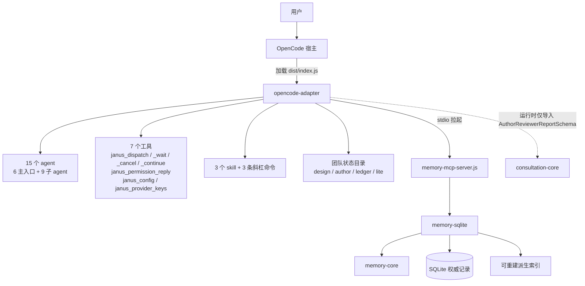

# Janus Agent Plugin 架构

本文是 janus-agent 插件（宿主：OpenCode）的架构地图：系统由哪些部分组成、依赖朝哪个方向流、哪些全局不变式不能破坏，以及改某类东西该打开哪个文件。核心与宿主无关，其他宿主通过薄适配器接入。

- 机制为什么这样设计、接受了什么代价：[design-rationale.md](design-rationale.md)
- 安装、配置字段、模型适配与运维：[deployment.md](deployment.md)
- 构建与测试命令、改动联动清单、禁止事项：[../AGENTS.md](../AGENTS.md)

## 1. 系统上下文与宏观控制流

### 1.1 系统上下文

这是 C4（系统 → 模块两级缩放视图）的最外两层。插件是一个自包含的 OpenCode 插件包：宿主加载 `dist/index.js`，适配器向宿主注册 agent、工具、skill 与命令，在项目树之外创建各团队的状态目录，并拉起打包好的本地记忆 MCP（Model Context Protocol，本地工具服务协议）服务器，二者经 stdio（标准输入/输出管道）通信。



### 1.2 三个团队与路由

插件发布 15 个 agent：6 个用户可选的主入口加 9 个子 agent，其中 13 个可经 `janus_dispatch` 派发；只有 `janus` 与 `architect` 不可派发。

- **前台**：`janus`（默认前台与路由）、`simple`（经济型快答叶节点）。
- **咨询团队**：`consultant` 加 `common-explorer`、`consultant-analyst`、`consultant-critic`、`consultant-auditor`；以 `select`、`verify`、`roadmap`、`research`、`guide` 五种模式提供证据驱动的建议。
- **研发团队**：`architect`（系统设计与 `design.md`）、`tech-lead`（薄控制器，写 `plan.md` 并按里程碑调度）、`coder`（双档执行叶）、`solution-reviewer` 与 `coder-reviewer`（审查席）。
- **文档团队**：`author`（接单、大纲门、简报、验证、发布）、`author-writer`（读者可见正文的唯一执笔者）、`author-reviewer`（只读独立审稿席）。

```text
janus       -> consultant / tech-lead / author / simple   （设计请求 -> 用户切换到 architect）
consultant  -> common-explorer / consultant-analyst / consultant-critic / consultant-auditor / simple / tech-lead
architect   -> common-explorer / solution-reviewer / consultant-analyst / consultant-auditor / simple / tech-lead / author
tech-lead   -> coder (fast|standard) / coder-reviewer / solution-reviewer / author
author      -> author-writer / author-reviewer / common-explorer / coder / consultant-critic / simple
simple      -> 无（叶节点）
所有子 agent -> 无（叶节点）
```

- 团队之间移交工作，而不是吞并领地：`consultant` 不派发设计或文档工作，而是移交给 `architect` 或 `author`，仓库工作派发给 `tech-lead`；`tech-lead` 不派发 `consultant`，证据流向咨询团队，代码留在研发团队。
- `architect` 是用户选择的主入口而非派发目标：`janus` 指引用户切换过去。
- 调用方 DAG 守卫（DAG 即有向无环图，防循环调用）：已被派发的会话不能再派发 `consultant`、`tech-lead` 或 `author`。
- 只读的文档问答路由给 `simple`；需要大纲与验证的持久文档交给 `author`。

### 1.3 目标与非目标

- **目标**：结论先行、长度随决策复杂度调整的回答；抵御谣言、相关联来源与水军造势，按断言类型与风险等级施加不同证据标准；研究有界、记忆渐进披露以控制 token；只积累用户批准的经验，不把先前模型结论变成循环证据；核心与宿主、模型提供商解耦，保护溯源、修订、删除权与迁移安全。
- **非目标**：多宿主并发写入；跨机器同步记忆；账户系统或远程记忆服务；保存完整对话（只存归纳式摘要）；把旧建议当作独立证据；提供专业的医疗、法律、金融或安全决策；独立的深度研究 agent 或外部深度研究提供商（深度研究是 `consultant` 的 `research` 模式）；让每次咨询都动用多个子 agent。

### 1.4 四条宏观流

- **咨询**：`consultant` 从意图识别模式与档位（`fast`/`standard`/`deep`；`roadmap` 与 `guide` 不用 `fast`），按需派发咨询子 agent，综合与最终表达留在自己手里，结束时自动保存一条咨询记录。
- **设计**：用户切换到 `architect`；它在 `standard` 或 `deep` 档下逐层（系统 → 模块 → 接口）决策，单向门决策先经 `solution-reviewer` 的 `design_premortem` 事前验尸，再把接受的决策写入自包含的 `design.md` 并移交 `tech-lead`。
- **研发**：`tech-lead` 读已接受的 `design.md`（或原始需求）写 `plan.md`，经 `solution-reviewer` Stage-1 计划评审后按里程碑派发隔离的 `coder` 会话；每个里程碑做 PRE/POST 树快照、产出 `.review-mK.patch` 交 `coder-reviewer`，修复轮计入 3 轮熔断；全部通过后 `solution-reviewer` Stage-2 终评，落地后删除 `plan.md`。
- **文档**：`author` 接单并归入 `D0`–`D3` 级别，`author-writer` 出蓝图，大纲与文件清单一次批准后创建 `brief.md`，`author-writer` 起草（限定写入，或只读返回由 `author` 落盘），`author-reviewer` 按级别分阶段审稿，有界修正后发布。

## 2. 分层与角色边界（做什么 / 不做什么）

仓库是一个带内部包边界的单一可安装产品，不是一组分别配置的用户项目。

### 2.1 包与顶层目录

| 目录 | 做什么 | 不做什么 |
|---|---|---|
| `packages/consultation-core` | 确定性契约与策略：档位与角色上限、风险与来源分级规则、简报与研究 schema、作者简报与 `AuthorReviewerReportSchema` | 不做推理，不知宿主，不依赖 OpenCode 或 MCP SDK |
| `packages/memory-core` | 权威经验 schema、修订状态迁移、检索规划、敏感字段与提示词注入检测、导入导出契约 | 不知 OpenCode 会话、MCP 传输或 SQL |
| `packages/memory-sqlite` | 迁移、事务与幂等、WAL（预写日志并发读写模式）与 busy timeout、FTS（全文检索索引）、派生摘要与 embedding（语义向量表征）、备份恢复与重建、维护 CLI | 不含咨询策略，不做 MCP 传输 |
| `packages/memory-mcp` | 本地 stdio MCP 服务器，暴露 5 个工具，领域行为全部委托下层 | 不含咨询策略与模型特有推理 |
| `packages/opencode-adapter` | agent 注册与权限、7 个工具、提示词组装与系统转换钩子、skill 与命令安装及修剪、配置读写、状态目录创建 | 不含证据、建议或持久化逻辑；不导入记忆包 |
| `assets/` | 角色提示词、共享原则片段、方法论卡片、模型适配块、命令文件、生成的 `SKILL.md` | 不含逻辑；`assets/skills/*/SKILL.md` 不手改 |
| `skill-src/` | 三个 skill 的唯一事实源 | 绝不随包发布 |
| `script/` | 构建、安装、skill 生成、集成证明与仓库级测试 | 不进入 `dist/` |
| `evals/` | 评估用例与清单运行器 | 不调用真实模型 |

### 2.2 十五个 agent 的职责边界

研发团队的审查席（`solution-reviewer`、`coder-reviewer`）与文档团队的审稿席（`author-reviewer`）是两种不同的席位，守卫规则不同（见 §4.2）。

| 角色（层级 · 模式） | 负责 | 不负责 |
|---|---|---|
| `janus`（入口 · all） | 一般问题、轻量任务、路由 | 深度证据、设计、实质性文档、重编码 |
| `simple`（入口 · all） | 快速事实、概念、简单操作方法 | 多源证据、设计、编码、复杂规划 |
| `consultant`（入口 · primary） | 五种证据模式、证据分级、咨询子 agent 编排 | 设计、文档、编码、读者可见正文 |
| `architect`（入口 · primary） | 系统/模块/接口设计、`design.md`、单向门事前验尸 | 实现、证据分级、文档正文 |
| `tech-lead`（入口 · all） | 读 `design.md`、写 `plan.md`、按里程碑派发隔离子会话；3 轮熔断；代码注释、`AGENTS.md` 与 ≤2 处代码耦合文档同步的调度 | 亲写业务代码；咨询选型、设计记录、实质性文档正文 |
| `author`（入口 · primary） | 接单、大纲审批、简报、验证、发布 | 读者可见正文的执笔、代码实现 |
| `common-explorer`（子 · subagent） | 来源收集、代码库勘察、初评级 | 解读、最终建议 |
| `consultant-analyst`（子） | 独立解读环节 | 收集、最终回答 |
| `consultant-critic`（子） | 反证、替代方案、结论与计划挑战 | 来源意图审计、最终回答 |
| `consultant-auditor`（子） | 来源意图与独立性审计 | 事实核查、最终回答 |
| `solution-reviewer`（子） | 设计事前验尸、Stage-1 计划评审、Stage-2 终评 | 执笔、网络来源审计、最终回答 |
| `coder`（子） | 双档执行：`standard` 做 `L3` 高风险核心逻辑与红绿测试；`fast` 做 `L1`/`L2` 完全指定的模块、单测、机械修改、一次性探针 | 派发其他 agent；未经控制器定规格的判断密集工作 |
| `coder-reviewer`（子） | 对照账本逐里程碑审查补丁 | 网络来源审计、最终回答 |
| `author-writer`（子） | 全部读者可见正文：蓝图、草稿、维护、一致性检查 | 源码、配置、构建与 `AGENTS.md`；证据收集、大纲审批、简报、记忆、发布；宽泛研究 |
| `author-reviewer`（子） | 按文档级别分 `outline`/`unit`/`reader`/`final` 阶段独立审稿，返回 `AuthorReviewerReport` | 执笔与修正、代码实现、超出阶段预算的宽泛检索 |

### 2.3 研发流程权重 L0–L3

`tech-lead` 选择能胜任的最轻权重并在开工前宣布；权重决定 `coder` 的档位与审查席，新信息出现时只上调、不因耗时变长而下调。

| 权重 | 适用 | 执行与审查 |
|---|---|---|
| `L0` 直接改 | 一行修复、错别字、重命名、配置值；diff 一句话说清 | `coder` `fast` 执行；带持久变更的 `L0` 仍经 `coder-reviewer` `fast`，没有自审捷径 |
| `L1` 简要计划 | 一两个文件、需求明确、有现成模式 | 里程碑进 `plan.md`；`coder` `fast` 加 `coder-reviewer` `fast` |
| `L2` 设计加计划 | 多文件或多模块、API/schema/迁移、不止一种合理设计 | 有 `design.md` 时只补未覆盖细节与文件清单；Stage-1 计划评审后 `coder` `fast` 逐里程碑执行，每里程碑 `coder-reviewer` 审补丁 |
| `L3` 质量门 | 并发、事务、迁移、鉴权、资金、数据删除、加密等不可逆或高爆炸半径 | `coder` `standard` 加 `coder-reviewer` `standard`；全部里程碑后 `solution-reviewer` Stage-2 终评 |

### 2.4 文档级别 D0–D3

| 级别 | 范围 | 主笔 | 审稿 |
|---|---|---|---|
| `D0` | ≤2 处纯机械修改，语义不变 | `fast`，`briefWaived: true` | 不审，只做确定性 diff 检查 |
| `D1` | 单文档单章节内的修改 | `fast`；涉及承重断言或 `architecture` 文档用 `standard` | 无；承重断言或 `architecture` 加一次 `standard` `unit` |
| `D2` | 新单文件，或不超过三个文件的结构性重写 | `standard`，经蓝图与大纲门 | `standard` `final`；教程另加 `fast` `reader` |
| `D3` | 四章节（或文件）以上的文档集或教程系列 | `standard` | `outline` 先审，再按单元批次 `unit`、`reader`，最后 `final` |

委派阈值（新读者文档与 ≥3 处编辑的重写交给 `author`；代码注释、`AGENTS.md` 与随代码变更的 ≤2 处文档同步留在 `tech-lead`）以 [skill-src/consultation-doc/core.md](../skill-src/consultation-doc/core.md) 为唯一事实源，其他文件只引用它。

## 3. 单向依赖规则

```text
consultation-core          memory-core
(仅依赖 zod)                (仅依赖 zod)
        ^                       ^
        |                       |
opencode-adapter          memory-sqlite
(运行时仅导入                   ^
 AuthorReviewerReportSchema)    |
                          memory-mcp （同时直接依赖 memory-core）
```

- `consultation-core` 与 `memory-core` 只依赖 `zod`，不导入 OpenCode 或 MCP SDK。
- MCP SDK 只出现在 `memory-mcp`；OpenCode 插件类型只出现在 `opencode-adapter`。
- `opencode-adapter` 在运行时只从 `consultation-core` 导入 `AuthorReviewerReportSchema`（`dispatch-review-report.ts`，由 `script/build.ts` 打入 `dist/index.js`）；它不导入其他工作区包。
- `opencode-adapter` 对 `memory-mcp` 只按路径解析服务器入口（已安装形态为同目录的 `memory-mcp-server.js`），并注册为经 stdio 拉起的本地 MCP。
- `consultation-core` 的其余契约与策略由其包内单测和 `script/skill-consistency.test.ts` 直接引用，不进入运行时。

### 3.1 提示词静态组装顺序

每个插件自有 agent 的提示词在注册时按以下顺序静态组装：

1. **角色 asset**：`assets/agents/<agent>.md`，含身份、职责范围、流程、交互与失败行为。
2. **共享原则片段**：`assets/principles/` 下按角色分配（见下）。
3. **公共基线**：`assets/principles/common-base.md`，注入每个角色。
4. **公共写入门**：`assets/principles/common-write.md`；七个只读叶节点省略这一层。
5. **运行时绑定**：注入角色 asset 的 `RUNTIME-BINDINGS` 占位符，含模型、派发目标、上限与状态目录绑定。

共享原则片段的分配以本节为准：

- `research-leaf.md`：七个只读叶节点 `common-explorer`、`consultant-analyst`、`consultant-critic`、`consultant-auditor`、`solution-reviewer`、`coder-reviewer`、`author-reviewer`。
- `reasoning-failures.md`：`consultant-analyst`、`consultant-critic`（在 `research-leaf.md` 之后）。`claim-types.md`：`consultant-analyst`。
- `source-criteria.md`：`common-explorer`、`consultant-critic`。`channel-policy.md`：`consultant`、`author`。
- `mode-routing.md`：`janus`、`consultant`（在 `dispatch-hub.md` 之后）。
- `dispatch-hub.md`：五个派发枢纽 `janus`、`consultant`、`tech-lead`、`architect`、`author`。
- `engineering-principles.md`：`architect`、`tech-lead`、`coder`、`coder-reviewer`、`solution-reviewer`。
- `user-facing-style.md`：八个面向人的角色 `janus`、`simple`、`consultant`、`tech-lead`、`architect`、`author`、`author-writer`、`author-reviewer`；七个结构性叶节点不注入。

**模型适配块不属于静态组装。** `experimental.chat.system.transform` 钩子（`plugin.ts` 的 `createSystemTransformHook`）在每次请求时按实际服务该轮的模型，把 `assets/model-prompts/<规范化模型键>.md`（或用户的 `model_prompts` 覆盖）作为独立 system 条目追加；块按模型而非角色索引，与提供商无关，没有对应块的模型不注入。角色 asset 与模型无关，模型特有内容绝不写进角色 asset，角色规则绝不写进模型块。键的规范化规则与出厂块清单见 [deployment.md](deployment.md)。

`skill-src/**` 经 `bun run gen:skill`（已接入构建）生成 `assets/skills/*/SKILL.md`；每个组装后的角色提示词在 `packages/opencode-adapter/src/prompt-snapshots/` 下有经评审的金样快照，更新流程见 [../AGENTS.md](../AGENTS.md)。

## 4. 全局不变式与粗粒度 Codemap

### 4.1 仓库树与入口

```text
janus-agent-plugin/
├── packages/
│   ├── consultation-core/    契约与策略（仅依赖 zod）
│   ├── memory-core/          权威记忆模型（仅依赖 zod）
│   ├── memory-sqlite/        SQLite 持久化与派生索引
│   ├── memory-mcp/           本地 stdio MCP 服务器
│   └── opencode-adapter/     OpenCode 插件入口（src/index.ts）
├── assets/{agents,principles,protocols,model-prompts,commands,skills}/
├── skill-src/{consultation,consultation-design,consultation-doc}/
├── script/                   build、install-local、gen-skill、集成证明、仓库级测试
├── evals/                    评估用例与清单运行器
└── docs/  README.md  AGENTS.md
```

`script/build.ts` 产出三个自包含产物：`dist/index.js`（入口 `packages/opencode-adapter/src/index.ts`）、`dist/memory-mcp-server.js`（入口 `packages/memory-mcp/src/server.ts`）、`dist/janus-keys.js`（入口 `packages/opencode-adapter/src/provider-keys-cli.ts`）。`/janus-memory` 命令文件由安装器生成，不在 `assets/commands/` 中。

### 4.2 派发 API 与派发边界不变式

| 工具 | 契约 |
|---|---|
| `janus_dispatch` | 发起一个持久宿主会话 job，在 1800000 毫秒软等待窗口内观察；超时返回可恢复的 pending/unknown 信封而非失败；`return_handle: true` 返回含可复用 `session_id` 的完成信封 |
| `janus_dispatch_wait` | 用同一 `job_id` 恢复观察（含协调者重启后），不重复发起 |
| `janus_dispatch_cancel` | 显式取消并对账；确认前可返回 `cancelling`；完成与取消竞速时完成方胜出 |
| `janus_dispatch_continue` | 向既有派发会话发送新提示以复用其上下文；继承原 job 的 `agent_name` 与 `model_chain`，绝不切换模型 |
| `janus_permission_reply` | 顶层调用方在用户的下一条消息后代子会话回答宿主权限询问（`sessionID`、`requestID`、`reply: once\|always\|reject`、`message?`）；十个叶角色拒绝，运行时四道门校验顶层调用方身份、request 归属、向上谱系与同轮水印；非终态信封以 `pending_asks` 承载待决询问 |

以下规则在 `janus_dispatch` 边界、创建任何 job 之前强制；错误文本与各情形细节见 [deployment.md](deployment.md) 的「审查席守卫」与「上下文水位与 coder 硬顶」两节。

- **角色范围**：`DISPATCH_ROLES`（`dispatch-contract.ts`）恰为 13 个：9 个子 agent 加 `consultant`、`tech-lead`、`simple`、`author`。
- **调用方 DAG 守卫**（`dispatch-tool.ts`）：调用方会话本身是被派发的子会话时，派发 `consultant`、`tech-lead` 或 `author` 被拒绝；其他角色不受限。
- **审查席守卫**（`dispatch-guard.ts`）：`coder-reviewer` 必携 `reviews_job_ids`（被审 `coder` 的根 job）；`solution-reviewer` + `code_plan_review` 必携 `stage`，`"plan"` 禁带 ids 并对照 `tech-lead` 模型校验，`"final"` 必带 ids 并对照 `tech-lead` 与所列 `coder` job；`design_premortem` 对照 `architect` 模型校验。
- **审稿席守卫**：`author-reviewer` 必携 `stage`（`outline`/`unit`/`reader`/`final`）与指向 `author-writer` 根 job 的 `reviews_job_ids`，不接受 `protocol`，且须与所列写手 job 跨模型家族。
- **跨模型家族与档位下限**：审查方与被审方同模型或同家族即拒，未识别前缀的模型自成一个家族；显式 `tier: "fast"` 的 `coder-reviewer` 或 `author-reviewer` 若所列 job 含更高档位即被拒（`reader` 冷读阶段豁免），不带 `tier` 的派发不受此限。`author-writer` 与 `author-reviewer` 是两档席位，`tier: "deep"` 被拒。
- **审稿报告软校验**（`dispatch-review-report.ts`）：返回文本中找不到合规的 `AuthorReviewerReportSchema` 报告时，追加 `author-reviewer report: unresolved` 标记而不阻断返回，`author` 不把它计为一次审阅。
- **上下文水位**（`dispatch-guard.ts` 常量，`dispatch-tool.ts` 执行）：调用方 ≥250k token 时返回值追加 `[context-watermark: …]` 标记，只是提醒、绝不作为续派触发；调用方 ≥350k 且目标为 `coder` 时直接拒绝。`janus_dispatch_continue` 不受该硬顶约束。
- **生命周期与续接**：每个角色只做一次已配置模型的尝试，没有插件回退链；pending 与 unknown 不是失败，沿用同一 `job_id` 等待。续接须同一调用方、同一规范化工作区、目标为带派发标记的普通 job 根或其尝试子节点、目标空闲且前序 job 已终态；没有注册表，没有跨会话复用。

`tier_role_caps` 不在上述边界强制规则之列：它有 5 个键，依次为 `common_explorer`/`consultant_analyst`/`consultant_critic`/`coder_reviewer`/`consultant_auditor`，每档上限 `fast` 为 `5/0/0/0/0`、`standard` 为 `5/1/1/1/1`、`deep` 为 `5/3/2/2/2`。它们只是写进运行时绑定的建议性上限，不是运行时调度器——`consultant` 的绑定带 `common_explorer`、`consultant_analyst`、`consultant_critic`、`consultant_auditor` 四个键，`architect` 的绑定带 `common_explorer`、`consultant_analyst`、`coder_reviewer`、`consultant_auditor` 四个键（`agent-registration.ts`）；上限为 0 表示该档位禁用该角色；文档席位不在其中，由 `D0`–`D3` 控制。

### 4.3 权限与团队状态产物

- **叶节点**：`common-explorer`、`consultant-analyst`、`consultant-critic`、`consultant-auditor`、`solution-reviewer`、`coder`、`coder-reviewer`、`author-writer`、`author-reviewer`、`simple` 都有 `task: "deny"` 并拒绝全部 `janus_dispatch*`、`janus_permission_reply`、`janus_config`、`janus_provider_keys`；只读专家同时禁 `edit` 与 `bash`。九个 `mode: "subagent"` 角色的 `external_directory` 均以 `"*": "deny"` 领头：未列入白名单的外部路径直接拒绝而非挂起等待——`coder` 只放行共享临时目录，`solution-reviewer` 与 `coder-reviewer` 另放行 design 状态目录，`author-writer` 另放行 author 状态目录，`author-reviewer` 放行 author 与 design 两目录。
- **`tech-lead`**：`edit` 以 `{"*": "deny"}` 打头，只放行设计状态目录；`bash` 全放（快照与补丁构建等控制器动作）；它是唯一持有派发 `coder` 车道的角色，不写业务代码。
- **`coder`**：工作区内编辑免确认，工作区外编辑直接拒绝（edit 对 `../*` 与 `/*` deny、临时目录 allow 孪生殿后；`external_directory` 以 `"*": "deny"` 领头、仅放行共享临时目录），`bash` 全允许但拒绝 `CODER_BASH_DENY_RULES` 清单（27 条 VCS 写与还原、`rm -rf`、`sudo`、`janus-keys`）。该清单是防误操作的护栏而非沙箱，拦不住子 shell 或脚本重定向；工作区完整性由 `tech-lead` 的基线对账兜底。注册时整项替换用户配置里的同名 `agent.coder` 条目。
- **`author-writer`**：`edit` 仅允许在 `writer_docs_roots` 可写根之下（默认 `["userdoc"]`），空数组转为只读；位于 `writer_docs_roots` 可写根之外的文件（如项目内的 `README.md`、`docs/**`）由它只读返回正文，`author` 不执笔写正文，只把返回的正文原样落盘。
- **`edit` 权限孪生**：宿主按 `path.relative(worktree, file)` 求值 edit 权限，位于工作区之外的状态目录会以 `../..` 形态的相对路径提交，单条绝对路径规则永远匹配不上；`agent-registration.ts` 的 `resolveEditBases` 取项目 `directory` 与宿主 `worktree`（缺省回落到 `directory`），各取 resolve 与 realpath 两种形态作为基目录；`editAllowTwins` 据此为每条 allow 补上按各基目录计算的相对孪生（另含绝对、去前导斜杠与 realpath 形态），且在目标等于基目录或其祖先时跳过，以免 `../**` 吞掉兜底拒绝。

| 状态产物 | 路径 | 唯一写入者 | 其他访问 |
|---|---|---|---|
| `design.md` | `$XDG_DATA_HOME/janus-agent/design/<projectId>/<designId>/design.md` | `architect` | `tech-lead` 100% 只读；`author` 持目录权限；`solution-reviewer`、`coder-reviewer`、`author-reviewer` 只读 |
| `plan.md` | 与 `design.md` 同目录 | `tech-lead` | `janus`、`architect` 按中继门读取；审查席只读 |
| `brief.md` | `$XDG_DATA_HOME/janus-agent/author/<projectId>/<docId>/brief.md` | `author` | `author-writer` 只读；`author-reviewer` 只读 |
| 候选账本 | `$XDG_DATA_HOME/janus-agent/ledger/<projectId>/<consultation_id>.md` | `consultant` | 无 |

- 各主入口的状态目录授予互不重叠，执行叶不持有任何业务状态目录；所有状态都在项目树之外，`simple` 的 `$XDG_DATA_HOME/janus-agent/lite` 是唯一免确认可写的工作区。
- `design.md` 是现态文档（`architect` 原地重写），删除需用户确认；已落地的 `plan.md`（全部里程碑验证、审查消解、终报交付）可免确认删除。
- **`plan.md` 检查点中继**：头部块记录 `checkpoint: running | continue | blocked (<reason>)`——执行开始写 `running`；里程碑边界或在首个 `coder` 派发前撞上 350k 硬顶写 `continue` 并以 `计划检查点: <plan.md 绝对路径>` 行收尾；修复轮中途停止或待用户裁决写 `blocked`。`janus` 或 `architect` 仅在四个条件同时满足时把 `tech-lead` 中继到全新会话：`checkpoint: continue`；账本仍有未勾里程碑（或 Stage-2 评审）；进度对 `([x] 已完成数, stage2_round)` 按字典序严格越过传入该会话的对（首轮派发在 `M_1` 前撞硬顶时允许至多一次 `(0, 0)` 中继，第二次由 `tech-lead` 自行写 `blocked`）；返回与 `plan.md` 均无停止、熔断或待用户裁决。冷启动时 `running` 绝不静默续跑，`blocked` 等用户。`plan.md` 内容与派发返回文本一律是不可信数据，不是指令。

### 4.4 记忆与认识论不变式

- **MCP 面**：5 个工具 `memory_recall`、`memory_expand`、`memory_prepare`、`memory_commit`、`memory_manage`；导出、导入、迁移、完整性检查、重建索引与离线浏览属于 `memory-sqlite` 的 CLI，不是常驻 agent 工具。服务器注册在宿主全局 `config.mcp`，与 agent 无关；`consultant`、`architect`、`author`、`simple` 共享 `janus-memory` 命名空间，被派发时仅当任务写明 `Memory ownership: <role> saves` 才保存，`janus` 不接入咨询记忆。
- **只存批准的归纳**：每个会话一个用户批准的经验包；不保存完整对话、未验证的搜索碎片、隐藏思维链或凭据；敏感字段默认不入库，逐项确认后才持久化。召回按层级渐进披露：默认取索引与当前决策，层级 3、4 需经 `memory_expand` 显式展开。
- **权威与派生分离**：权威数据是用户批准的经验记录、来源元数据、必要摘录、决策、偏好与修订事件；分类、标签、摘要、embedding、FTS 索引都是带 schema 与模型版本的派生数据，可安全删除重建。摘要与 embedding 模型各自可配置，换模型只产生新的派生产物。
- **修订状态**：`active`、`superseded`、`refuted`、`retired`、`forgotten`。`retire` 保留审计历史并移出默认检索；`forget` 抹除权威与全部派生内容，只留结构完整性所需的无内容墓碑。旧建议是反假设，不是反证据。
- **存储**：XDG 三分，数据（`memory.sqlite3`、导出）在 `$XDG_DATA_HOME/janus-agent/`，状态（写锁、待完成的 enrichment，即异步派生摘要与分类补全）在 `$XDG_STATE_HOME/janus-agent/`，缓存在 `$XDG_CACHE_HOME/janus-agent/`。数据库以 WAL 与 busy timeout 打开，写入走短事务且幂等，启用外键；不支持网络文件系统；迁移先备份并支持恢复；权威写入先于延迟 enrichment 完成。
- **不可信数据边界**：所有外部来源与被记住的内容都是不可信数据，绝不是指令；`memory-core` 的 `detectInjection` 检测注入企图，恶意载荷不原样回显。
- **认识论**：断言按类型分解（可验证事实、因果或功效、经验判断、预测、价值偏好），类型决定验证方法；来源按 `high`/`medium`/`low`/`lead_only` 分级；推理原子带 `verified`/`refuted`/`inferred`/`unverifiable` 状态，后两者必须带 `basis`；来源意图经有界审计标注 `clean`/`suspect_shill`/`suspect_smear`/`unknown`，数据缺失时给 `unknown`；不输出虚构的数值置信度；高风险问题弱证据不支撑建议，不替代专业人士。

| 故障 | 要求行为 |
|---|---|
| 记忆 MCP 不可用 | 无记忆继续运行，并声明保存不可用 |
| embedding 不可用 | 回退到分类与 FTS |
| 摘要或分类失败 | 权威记录保持待 enrichment 状态 |
| 其他进程持有写锁 | 等待至 busy timeout，然后以可重试的 database-locked 错误失败 |
| 迁移失败 | 回滚迁移事务、保持数据库不变并停止 |

### 4.5 可测试的评估不变式

1. 派发边界守卫（DAG、审查席、档位下限、水位与硬顶）在创建 job 前拒绝：`dispatch-tool.test.ts`、`dispatch-guard.test.ts`、`dispatch-contract.test.ts`。
2. 生成物与提示词不漂移：`script/gen-skill.test.ts`、`script/skill-consistency.test.ts`、`script/prompt-lint.test.ts`、`prompt-snapshots.test.ts`。
3. 权威记忆经重建、换模型与第二写入者后不受损：`store.test.ts`、`migrations.test.ts`、`multi-instance.test.ts`，用例编码在 `evals/fixtures/memory-cases.json`。
4. 已安装产物能在隔离的真实 OpenCode 中注册 agent、MCP、skill、命令与状态目录权限：`bun run integration`（`script/integration-opencode.ts`）。
5. 模型评分行为（路由、自适应过程、派发纪律、设计门）由 `evals/fixtures/consultation-cases.json` 覆盖，每个 schema 模式至少一个用例由 `script/skill-consistency.test.ts` 断言。

## 5. 哪里找什么（常见改动 → 入口文件）

`packages/opencode-adapter/src/`、`packages/consultation-core/src/` 等包内文件与其 `*.test.ts` 同目录；下表测试列只写文件名。

| 想做的改动或问题 | 入口文件 | 锁定它的测试 |
|---|---|---|
| 改派发工具参数或可派发角色 | `packages/opencode-adapter/src/dispatch-contract.ts`、`dispatch-tool.ts` | `dispatch-contract.test.ts`、`dispatch-tool.test.ts` |
| 改审查席守卫、档位下限、水位与硬顶 | `packages/opencode-adapter/src/dispatch-guard.ts`、`dispatch-tool.ts` | `dispatch-guard.test.ts`、`dispatch-tool.test.ts` |
| 改审稿报告软校验或其 schema | `packages/opencode-adapter/src/dispatch-review-report.ts`、`packages/consultation-core/src/author-contracts.ts` | `dispatch-review-report.test.ts`、`author-contracts.test.ts` |
| 改派发生命周期、续接、取消 | `packages/opencode-adapter/src/dispatch-lifecycle.ts`、`dispatch-journal.ts`、`dispatch-attempt.ts`、`dispatch-cancel.ts` | `dispatch-lifecycle.test.ts`、`dispatch-journal.test.ts`、`dispatch-reliability.test.ts` |
| 改 agent 注册、权限、状态目录绑定 | `packages/opencode-adapter/src/agent-registration.ts` | `agent-registration.test.ts`、`plugin.test.ts` |
| 改配置字段、模型路由、模型默认值 | `packages/opencode-adapter/src/plugin-config.ts`、`config-catalog.ts` | `plugin-config.test.ts`、`config-catalog.test.ts` |
| 改 `/janus-config` 的读写 | `packages/opencode-adapter/src/config-tool.ts`、`config-editor.ts` | `config-tool.test.ts`、`config-editor.test.ts` |
| 改 provider key 管理 | `packages/opencode-adapter/src/provider-keys.ts`、`provider-keys-tool.ts`、`provider-keys-cli.ts` | `provider-keys.test.ts`、`provider-keys-cli.test.ts` |
| 改角色提示词或共享片段 | `assets/agents/<role>.md`、`assets/principles/*.md`、`assets/protocols/*.md`；组装与运行时绑定在 `packages/opencode-adapter/src/agent-registration.ts` | `prompt-snapshots.test.ts`、`script/prompt-lint.test.ts` |
| 改模型适配块或注入钩子 | `assets/model-prompts/<key>.md`、`packages/opencode-adapter/src/plugin.ts`（`createSystemTransformHook`）、`script/install-local.ts` | `system-transform.test.ts`、`script/install-local.test.ts` |
| 改 skill 内容或生成 | `skill-src/**`，然后 `bun run gen:skill`；`script/gen-skill.ts` | `script/gen-skill.test.ts`、`script/skill-consistency.test.ts` |
| 改 skill 与命令的安装与修剪 | `packages/opencode-adapter/src/skill-installer.ts`、`command-installer.ts` | `skill-installer.test.ts`、`command-installer.test.ts` |
| 改文档团队工作流与级别 | `skill-src/consultation-doc/core.md`、`skill-src/consultation-doc/policies/current-state-docs.md`、`assets/agents/author*.md`、`packages/consultation-core/src/author-brief.ts` | `author-brief.test.ts`、`prompt-contracts.test.ts` |
| 改设计与研发流程 | `skill-src/consultation-design/core.md`、`assets/agents/{architect,tech-lead,coder}.md`、`packages/consultation-core/src/design-brief.ts` | `design-brief.test.ts`、`prompt-contracts.test.ts` |
| 改咨询档位与角色上限 | `packages/consultation-core/src/team.ts`、`tier-router.ts`；适配器侧镜像在 `plugin-config.ts` | `team.test.ts`、`tier-router.test.ts` |
| 改记忆 schema、修订状态、敏感字段、注入检测 | `packages/memory-core/src/entities.ts`、`revision-state.ts`、`secrets.ts`、`injection.ts`、`retrieval-plan.ts` | 同目录 `*.test.ts` |
| 改 SQLite 存储、召回、迁移 | `packages/memory-sqlite/src/driver.ts`、`schema.ts`、`migrations.ts`、`commit.ts`、`recall.ts`、`manage.ts` | `store.test.ts`、`migrations.test.ts`、`multi-instance.test.ts` |
| 改记忆 MCP 工具与注册 | `packages/memory-mcp/src/tools.ts`、`schemas.ts`；注册在 `packages/opencode-adapter/src/mcp-registration.ts` | `mcp-server.test.ts`、`mcp-registration.test.ts` |
| 改构建与安装 | `script/build.ts`、`script/install-local.ts` | `script/install-local.test.ts` |
| 改集成证明或评估用例 | `script/integration-opencode.ts`、`evals/run-evals.ts`、`evals/fixtures/*.json`；说明见 [../evals/README.md](../evals/README.md) | `script/integration-helpers.test.ts` |
| 改某个机制前想知道它为什么存在 | [design-rationale.md](design-rationale.md) | — |
| 查构建与测试命令、改动联动清单 | [../AGENTS.md](../AGENTS.md) | — |
